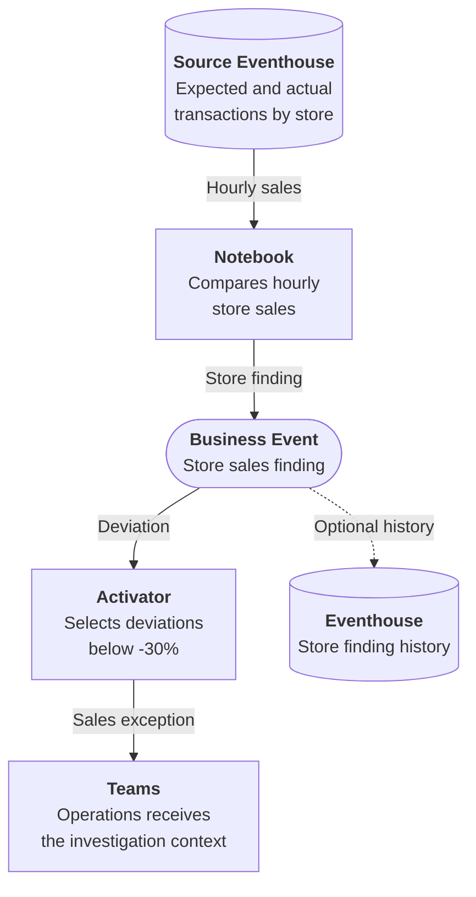
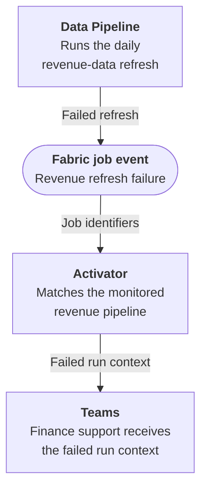
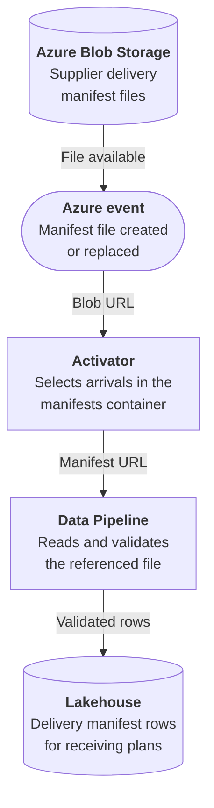

# Event-Driven Architectures in Microsoft Fabric

Scheduled checks and direct calls work well when timing and dependencies are explicit. They become less suitable when several teams need to react independently to the same finding, or when work should start after a specific change rather than another scheduled check.

**Event-driven architecture** separates the fact from the response. A workload or service emits an event describing what happened. Subscribed workloads apply their own policies and start the relevant action, without the source having to call each recipient.

## Why it matters for Fabric

In Microsoft Fabric, this can mean bringing a store sales exception to operations, flagging a failed revenue refresh for finance support, or loading a supplier manifest after its arrival in Azure storage.

Each design needs an identifiable source, an event with a clear meaning, a policy that selects the relevant cases, and a concrete response. The event family depends on what happened: a business finding, a Fabric platform change, or a change in an Azure resource.

## The three event pillars

### Business Events: investigate a store sales drop

Store operations needs to know which locations have a significant transaction-volume drop, with enough context to begin an investigation. A Notebook compares actual and expected hourly transactions and shares each store finding as a **[Business Event](../introduction/what-are-business-events.md)**. Activator owns the response policy: notify operations only when the deviation is strictly below -30%.

The business contract is `Retail.Sales.VolumeAlert`, not "the Notebook finished." The finding can support another response without changing the sales comparison. Optional **Analyze in Eventhouse**, selected when creating the Business Event, records finding history separately from the required source Eventhouse.

The outcome is an investigation prompt, not a diagnosis or evidence that sales recovered. The [Sales Volume Alert Workbook](../scenarios/sales-volume-alert/deployment.md) implements this pattern.

### Fabric Events: flag a failed revenue refresh

Finance support needs to know when the daily revenue-data refresh fails, so a failed load is not mistaken for current reporting. **[Fabric Events](../../fabric-events/index.md)** expose the job lifecycle automatically; the pipeline does not need additional code to describe its own failure.

Select `Microsoft.Fabric.ItemJobFailed` and scope the Activator rule to the intended `data.workspaceId` and `data.itemId`. Include `data.jobStatus` and `data.jobInstanceId` in the notification so support can identify the run and its outcome; this event type also covers stuck or canceled jobs. The platform event does not explain the cause, validate the report, or retry the load.

See the [Fabric job event types and payload](https://learn.microsoft.com/fabric/real-time-hub/explore-fabric-job-events). The event source and its Activator item must be in the same region.

### Azure Events: load a supplier delivery manifest

Receiving needs the supplier's delivery manifest available for planning without repeatedly checking a storage folder. **[Azure Events](../../azure-events/index.md)** provide the file-arrival signal from Azure Blob Storage. A matching arrival starts a configured ingestion pipeline rather than a notification that someone still needs to turn into a load.

The [Azure Blob Storage event source](https://learn.microsoft.com/fabric/real-time-intelligence/event-streams/add-source-azure-blob-storage) connects the storage account to Fabric. Activator can act on its unstreamed events; conversion to an Eventstream data stream is not required for this route. Filter `Microsoft.Storage.BlobCreated` to the manifests container and pass `data.url` to a pipeline parameter.

The event contains metadata, not the manifest rows. The pipeline reads the file through its configured storage connection, validates it and writes the Lakehouse. Its load logic must handle repeated notifications and file replacements. A stored manifest does not confirm that the physical delivery arrived.
