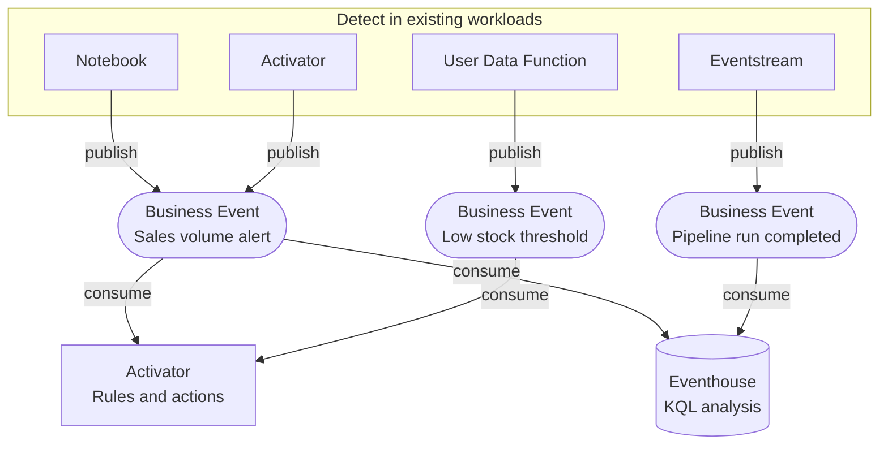
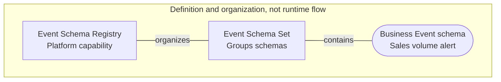
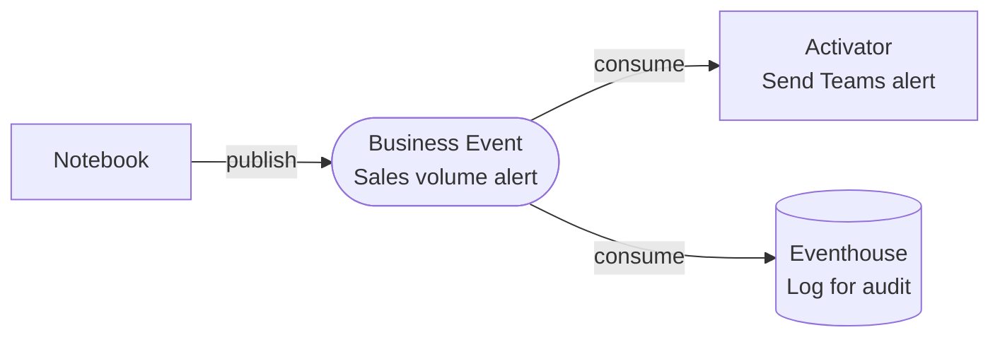

# Architecture Overview

Business Events connect existing detection workloads with independent consumers through a shared event contract in Microsoft Fabric. A notebook, function, stream, or rule can keep recognizing a business condition while publishing a representation that other teams can reuse. This page explains how the components fit together.

## High-level architecture

Read from top to bottom: existing detection workloads, shared Business Event contracts, then independent consumers. Arrows show publication and consumption, not a required processing sequence across consumers. These are example routes, not an exhaustive compatibility matrix. Short event labels map to the full names below.

| Diagram label | Event type |
|---|---|
| Sales volume alert | `Retail.Sales.VolumeAlert` |
| Low stock threshold | `Retail.Inventory.LowStockThreshold` |
| Pipeline run completed | `DataOps.Pipeline.RunCompleted` |

Real-Time Hub is the entry point for creating and discovering Business Events. The Event Schema Registry is a platform-level capability, not a runtime stage between the publisher and consumer.

## Event Schema Registry

The **Event Schema Registry** is a platform-level capability in Microsoft Fabric that stores and validates all schema definitions. Business Events are a special type of event schema stored in the registry, organized into **Event Schema Sets**.

Lines show schema organization, not event delivery. The example schema is `Retail.Sales.VolumeAlert`; the runtime publication and consumption paths are shown in the high-level architecture above.

Business Events cannot be created directly from the Event Schema Registry. They must be created from **Real-Time Hub → Business Events**. During creation, you can create a new Event Schema Set inline or select an existing one. The Event Schema Registry is the underlying storage; Real-Time Hub → Business Events is the entry point.

Before publishing, go to [Real-Time Hub → Business Events](https://learn.microsoft.com/en-us/fabric/real-time-hub/business-events/create-business-events) and create your Business Event from there. You will be prompted to create or select an Event Schema Set as part of the flow.

## Component roles

### Publishers
Any workload that detects a meaningful condition and signals it to the rest of the platform.

| Publisher | Best suited for |
|-----------|----------------|
| **[Notebook](https://learn.microsoft.com/en-us/fabric/data-engineering/how-to-use-notebook)** | Batch analysis results, data quality checks, scheduled monitoring |
| **[User Data Function](https://learn.microsoft.com/en-us/fabric/data-engineering/user-data-functions/user-data-functions-overview)** | External webhook normalization, custom integrations |
| **[Eventstream](https://learn.microsoft.com/en-us/fabric/real-time-intelligence/event-streams/overview)** | Real-time stream threshold conditions |
| **[Activator](https://learn.microsoft.com/en-us/fabric/real-time-intelligence/activator/activator-introduction)** | Re-publishing derived events from existing rules |

### Real-Time Hub
The entry point for creating and discovering Business Events in Microsoft Fabric. Event schemas are organized in Event Schema Sets in the platform-level Event Schema Registry; the diagram does not imply that the registry is hosted inside the Real-Time Hub interface.

### Consumers
Workloads that subscribe to one or more Business Events and react when a matching event arrives.

| Consumer | Best suited for |
|----------|----------------|
| **[Activator](https://learn.microsoft.com/en-us/fabric/real-time-intelligence/activator/activator-introduction)** | Triggering alerts, notifications, or downstream actions based on event conditions |
| **[Eventhouse](https://learn.microsoft.com/en-us/fabric/real-time-intelligence/eventhouse)** | Persisting events for historical analysis and KQL queries |

## One event, multiple consumers

A single Business Event can support independent responses in multiple consumers. Adding a consumer that uses the existing contract does not require changing the publisher.

The event is `Retail.Sales.VolumeAlert`. Both consumers use the same contract; neither waits for the other to complete.

This fan-out pattern separates detection from downstream responses. It is useful when several teams need the same finding, while direct service calls remain appropriate when a workload needs an immediate response to continue.
