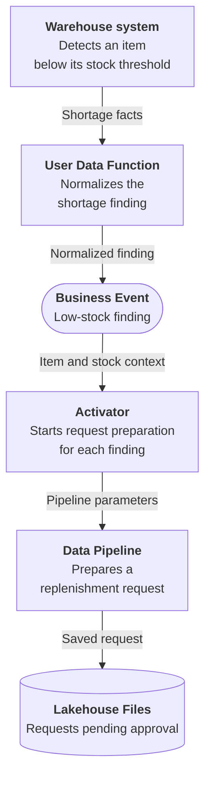
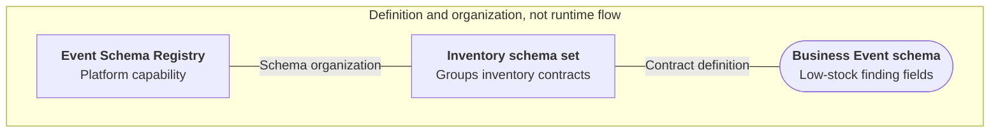
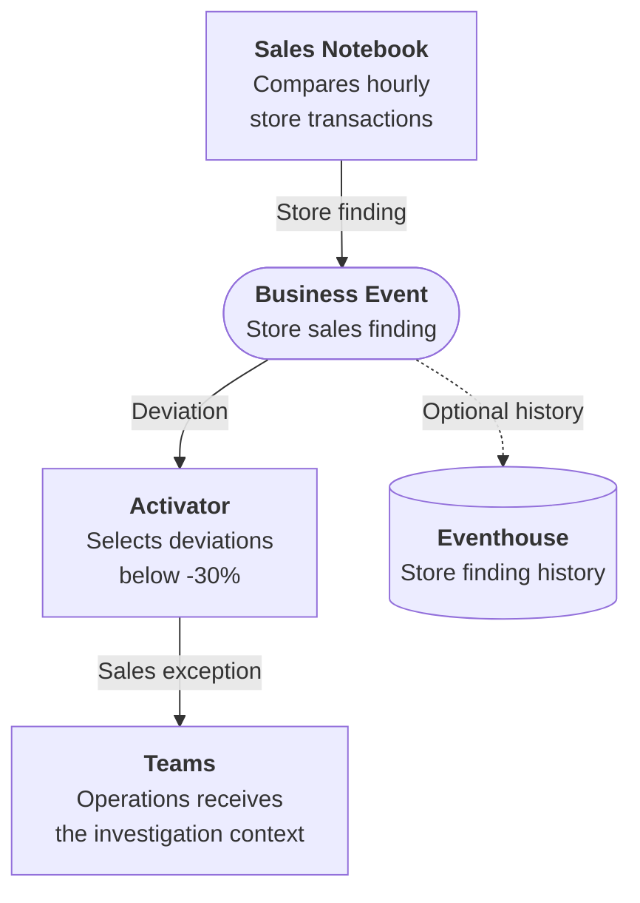

# Architecture Overview

Business Events separate the workload that recognizes a business condition from the workloads that respond. A warehouse shortage can become a purchasing request, for example, without the warehouse system taking responsibility for Fabric pipeline orchestration or the purchasing decision.

This page follows that low-stock handoff through its technical components, then shows how another finding can support independent operational and analytical responses.

## High-level architecture

The business contract is `Retail.Inventory.LowStockThreshold`. The warehouse retains its existing detection policy; the User Data Function adapts an already-detected finding to that contract rather than running a second stock test.

| Responsibility | Low-stock implementation |
|---|---|
| Detect the condition | The external warehouse system identifies the item and location below threshold. |
| Share the finding | A User Data Function sends the item, warehouse, stock, threshold, supplier context and observation time. |
| Start the response | Activator invokes the Data Pipeline with the original event fields. |
| Produce reviewable work | The pipeline saves a JSON request in Lakehouse Files with status `pending_approval`. |

The outcome is a request ready for purchasing review, not an approved order or replenished inventory. The [Low Stock Threshold Workbook](../scenarios/low-stock-threshold/deployment.md) provides the configuration and executable example.

Real-Time Hub is the entry point for creating and discovering the event and configuring its response. It is not another data-processing step, and the Event Schema Registry is not a runtime hop between the function and Activator.

## Event Schema Registry

The **Event Schema Registry** is the platform-level capability that holds schema definitions, organized into **Event Schema Sets**. For inventory, a schema set groups the contract used by the publishing function and its consumers. It does not contain stock records or purchasing requests.

Lines show schema organization, not event delivery. The schema for `Retail.Inventory.LowStockThreshold` defines the shortage payload; individual findings travel through the runtime path above.

Create the Business Event from **[Real-Time Hub → Business Events](https://learn.microsoft.com/fabric/real-time-hub/business-events/create-business-events)**, selecting an existing Event Schema Set or creating one inline. Do not start from the Event Schema Registry. Configure the function's connection to that schema set and use the exact event type name when publishing.

## Component roles

### Publishers
A publisher supplies the shared finding. It can perform the detection itself or adapt a finding from an existing business system.

| Publisher | Example responsibility |
|-----------|----------------|
| **[Notebook](https://learn.microsoft.com/fabric/data-engineering/how-to-use-notebook)** | Compares expected and actual hourly store sales and shares each finding. |
| **[User Data Function](https://learn.microsoft.com/fabric/data-engineering/user-data-functions/user-data-functions-overview)** | Normalizes a warehouse shortage without replacing warehouse detection. |
| **[Eventstream](https://learn.microsoft.com/fabric/real-time-intelligence/event-streams/overview)** | Selects qualifying observations from a live stream and maps their fields to a business contract. |
| **[Activator](https://learn.microsoft.com/fabric/real-time-intelligence/activator/activator-introduction)** | Shares a revenue exception recognized by an existing monitoring rule. |

### Real-Time Hub
The place to define and discover the Business Event and configure a response such as an Activator rule. Schema organization and consumer setup are configuration responsibilities, distinct from processing an individual shortage.

### Consumers
Workloads that subscribe to one or more Business Events and react when a matching event arrives.

| Consumer | Example responsibility |
|----------|----------------|
| **[Activator](https://learn.microsoft.com/fabric/real-time-intelligence/activator/activator-introduction)** | Starts replenishment-request preparation, or selects sales exceptions for a Teams notification. |
| **[Eventstream](https://learn.microsoft.com/fabric/real-time-intelligence/event-streams/overview)** | Enriches a customer loyalty milestone with campaign reference data, filters eligible campaigns and writes candidates to Lakehouse Delta tables. |
| **[Eventhouse](https://learn.microsoft.com/fabric/real-time-intelligence/eventhouse)** | Retains finding history for KQL analysis when **Analyze in Eventhouse** is enabled at creation. |

Eventstream can be a publisher or a consumer, depending on the flow. In the [Customer Loyalty Milestone scenario](../scenarios/customer-loyalty-milestone.md), it receives a Business Event as its source and prepares campaign candidates; it does not issue benefits. These Lakehouse Delta tables are response outputs, separate from optional managed Eventhouse history.

The pipeline and Lakehouse Files in the low-stock design implement the response started by Activator. The Lakehouse request is operational output, not the managed Eventhouse history of the Business Event.

## One event, multiple consumers

A store sales finding has two distinct uses: bringing a qualifying exception to operations and retaining the comparison for later analysis. Activator applies the notification threshold; Eventhouse history can retain findings independently of that threshold.

Both branches use `Retail.Sales.VolumeAlert`; neither waits for the other to complete. The dashed branch requires **Analyze in Eventhouse** at Business Event creation. It is not a mandatory stage before the Teams action, and recording an event is not evidence that operations investigated it.

Adding a response that uses the existing contract does not require changing the Notebook. Each consumer still needs its own configuration and outcome verification. If one response must wait for another to finish, use explicit orchestration rather than assuming fan-out provides that sequence.

## Design boundaries

- **Detection stays with the source.** A scheduled sales comparison remains scheduled; a warehouse finding does not require another stock detector in Fabric.
- **Facts and actions have different lifecycles.** An accepted event, an Activator invocation and a saved request are different checkpoints. Verify the business output rather than treating publication as completion.
- **Responses must tolerate repeated delivery.** Use the source finding identity to avoid unintended duplicate work; a schema does not provide exactly-once business processing.
- **Business decisions remain explicit.** Preparing a replenishment request is not approving a purchase, just as a sales notification is not a completed investigation.
