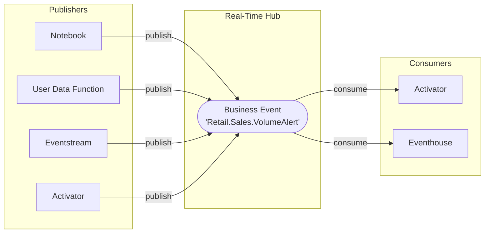

# What are Business Events?

A Business Event is a named, schema-defined representation of a meaningful business occurrence or detected condition. It gives teams a shared contract for communicating situations such as inventory falling below a threshold, a shipment being delayed, or a customer reaching a loyalty milestone.

The business signal is the meaning of that situation. The Business Event is how you represent and share an occurrence of it. Your existing notebooks, queries, rules, and applications can continue detecting the signal; consumers use the published event to support decisions, automation, and analysis.

!!! note "Official documentation"
    For the complete API reference and platform overview, see the [Business Events documentation on learn.microsoft.com](https://learn.microsoft.com/en-us/fabric/real-time-hub/business-events/business-events-overview).

## The core idea

Your team may already detect important conditions and respond through dashboards, alerts, or application integrations. The challenge grows when other teams need the same signal: each implementation may use a different name, interpretation, or payload, and a change to the business definition requires coordination across them.

Business Events provide a reusable representation of that signal. A **publisher** (a [Notebook](https://learn.microsoft.com/en-us/fabric/data-engineering/how-to-use-notebook), a [User Data Function](https://learn.microsoft.com/en-us/fabric/data-engineering/user-data-functions/user-data-functions-overview), an [Eventstream](https://learn.microsoft.com/en-us/fabric/real-time-intelligence/event-streams/overview), or [Activator](https://learn.microsoft.com/en-us/fabric/real-time-intelligence/activator/activator-introduction)) publishes an occurrence through **[Real-Time Hub](https://learn.microsoft.com/en-us/fabric/real-time-hub/real-time-hub-overview)**. **Consumers**, such as [Activator](https://learn.microsoft.com/en-us/fabric/real-time-intelligence/activator/activator-introduction) and [Eventhouse](https://learn.microsoft.com/en-us/fabric/real-time-intelligence/eventhouse), use that event independently, without the publisher calling each one.

For example, the same low-stock event can support an operations alert and inventory analysis. Adding a consumer that uses the existing contract does not require changing the publisher. Teams still need to agree on the signal's meaning, ownership, and evolution; the schema alone does not establish that agreement.

## Key concepts

**Schema-first design**
Every Business Event has a defined schema before publication. The schema uses a record format with typed fields, giving publishers and consumers an explicit data contract. Document what those fields mean and coordinate changes to that contract.

**Decoupled architecture**
Publishers do not call each consumer directly. Consumers depend on the event contract rather than a direct call from a particular publisher. New consumers can reuse that contract without changes to the publishing code.

**Real-time delivery**
Events reach configured consumers through Microsoft Fabric Real-Time Hub infrastructure. Detection frequency and downstream processing also affect how quickly the business can respond.

## Next steps

- [Architecture Overview](architecture-overview.md): understand how the pieces fit together
- [Event Schema](event-schema.md): learn the schema format and field types
- [Decision Guide](decision-guide.md): when to use Business Events vs alternatives
