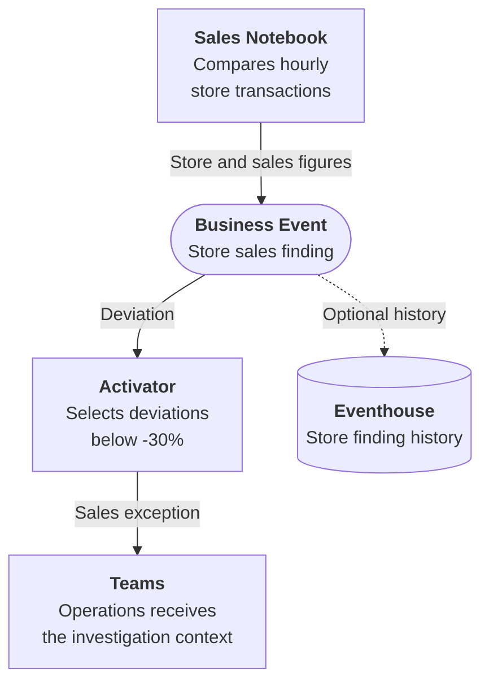

# What are Business Events?

A Business Event is a named, schema-defined representation of a meaningful business occurrence or detected condition. It gives teams a shared contract for communicating situations such as inventory falling below a threshold, a shipment being delayed, or a customer reaching a loyalty milestone.

The business signal is the meaning of that situation. The Business Event is the shared record of a particular occurrence: which store, shipment or customer, what happened, and when. Existing notebooks, queries, rules and applications keep their detection logic; other workloads use the event to start a response or retain the finding for analysis.

!!! note "Official documentation"
    For the complete API reference and platform overview, see the [Business Events documentation on learn.microsoft.com](https://learn.microsoft.com/fabric/real-time-hub/business-events/business-events-overview).

## The core idea

Consider store operations monitoring hourly transaction volume. A sales Notebook already compares expected and actual transactions. Operations needs the stores with a significant drop brought to its attention, while analysts need the findings available for later comparison.

Instead of adding a Teams integration and a history-writing routine to the Notebook, the sales workload shares a `Retail.Sales.VolumeAlert` Business Event. Each occurrence carries the store, time window, expected transactions, actual transactions and deviation. Activator applies the operations response threshold; optional Eventhouse history retains the same findings independently.

The Notebook is the **publisher**: it supplies the business finding. Activator and Eventhouse are **consumers**: they use that finding for different purposes. These are responsibilities in the design, not additional steps that a business user must perform.

Operations receives an investigation prompt only for deviations strictly below -30%; analysts can examine finding history when **Analyze in Eventhouse** is enabled at Business Event creation. Neither response changes the sales comparison or waits for the other. The event does not establish why sales fell or that anyone resolved the issue.

The [Sales Volume Alert Workbook](../scenarios/sales-volume-alert/deployment.md) implements this example. Other publishers, including User Data Functions, Eventstream and Activator, serve different detection and integration needs; the [Architecture Overview](architecture-overview.md) explains their roles.

## What makes the contract useful

| Contract element | Sales example | Why it matters |
|---|---|---|
| Named business meaning | `Retail.Sales.VolumeAlert` | Identifies a store sales finding, not merely a completed Notebook run. |
| Subject and observation time | `store_id`, `window_start` | Keeps the response tied to the correct location and trading hour. |
| Facts behind the finding | `expected_transactions`, `actual_transactions`, `deviation_pct` | Gives operations the original comparison rather than another request for an extract. |
| Response policy | Activator selects deviations below -30% | Separates the sales measurement from the decision to notify operations. |

Teams agree on the meaning, ownership and evolution of the contract. A schema enforces structure; it does not decide which findings deserve an action or make the business decision on a team's behalf.

## Key concepts

**Schema-first design**
Define the Business Event in **Real-Time Hub → Business Events** before sending occurrences. Its typed record schema describes the shared facts. For the sales example, the meaning and unit of `deviation_pct` must remain consistent across the Notebook and Activator rule.

**Decoupled architecture**
The Notebook does not call Teams or wait for historical analysis. A new response can reuse the existing contract without changing the sales calculation. Consumer configuration, permissions and verification are still required.

**Real-time delivery**
Configured consumers react after a finding is published. An hourly Notebook still detects on its hourly schedule; event delivery does not make that calculation continuous or guarantee that the downstream action completed.

## Next steps

- [Architecture Overview](architecture-overview.md): understand how the pieces fit together
- [Event Schema](event-schema.md): learn the schema format and field types
- [Decision Guide](decision-guide.md): when to use Business Events vs alternatives
