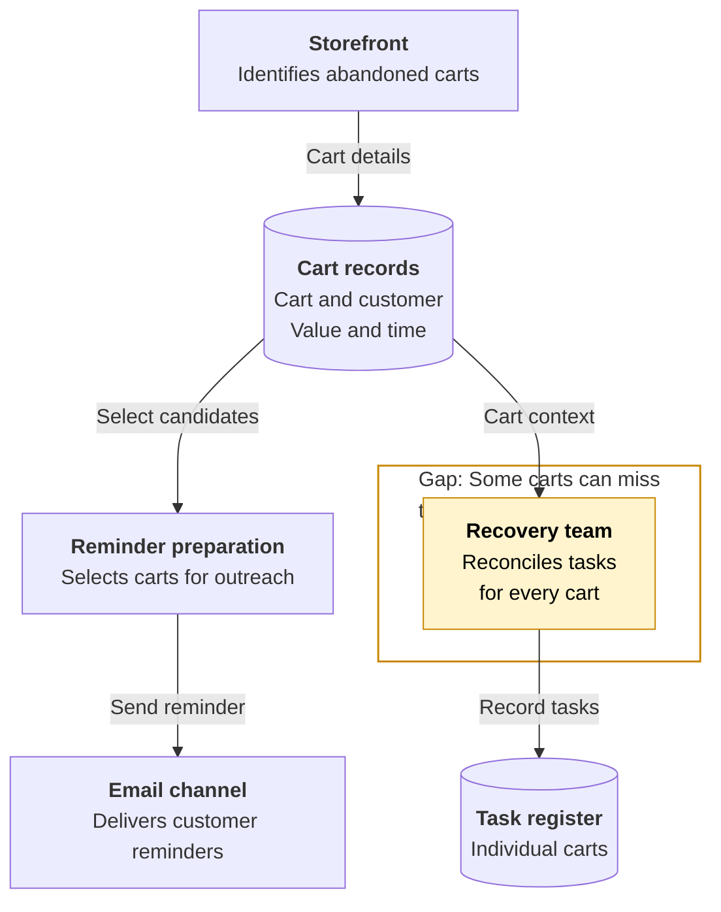
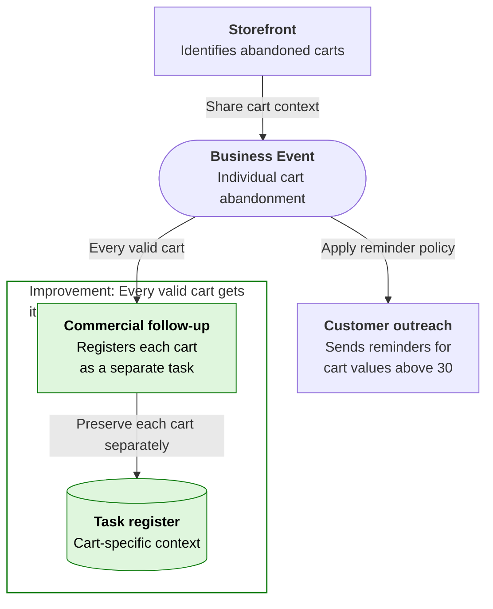
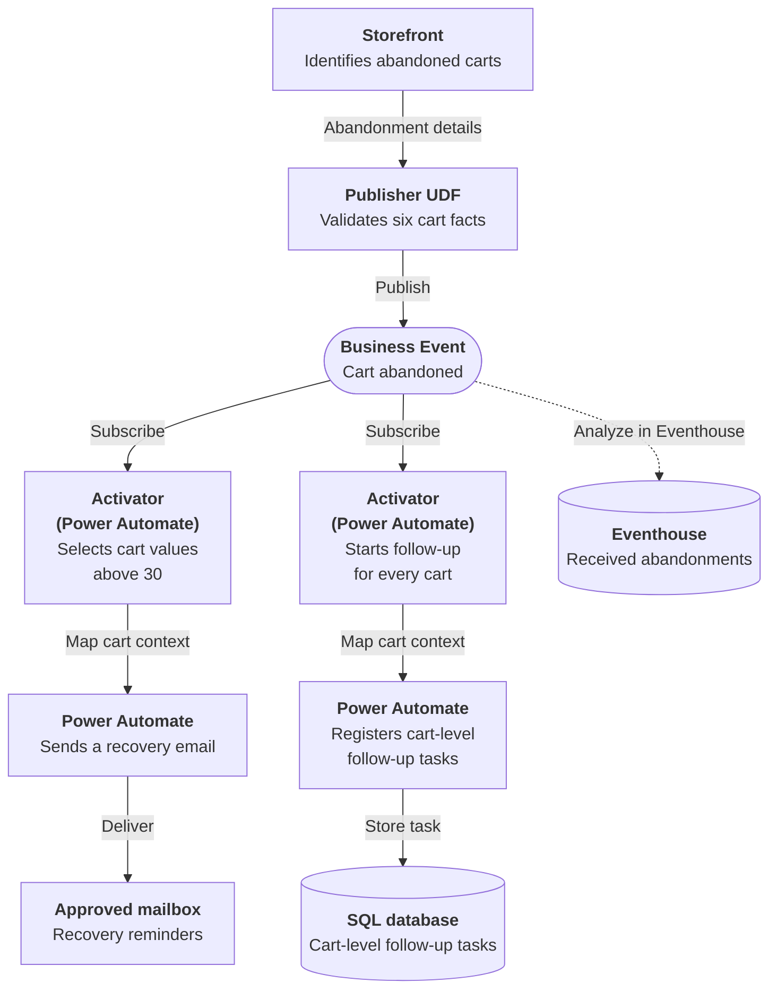

# Abandoned Cart Recovery

## Business Context

The storefront already identifies abandoned carts and retains the cart identity, customer details, value and time of abandonment. The recovery team uses those records to prepare customer reminders and to organize commercial follow-up. Those activities share the same starting facts, but they serve different purposes and do not have the same eligibility rules.

Here, reminder preparation selects the carts that merit an email, while the team separately maintains a register of cart-level tasks. Staff must reconcile those two views rather than assume that everyone receiving an email represents all the work to be done. A lower-value cart still needs a task, and two carts belonging to one customer are two separate opportunities to follow up. The risk is incomplete coverage, not simply a missing email.

## Current Problem

Reminder eligibility and follow-up coverage are not the same policy. If the reminder list is treated as the complete worklist, lower-value carts disappear from follow-up. If work is recorded only against the customer, separate carts can lose their individual context.

The team needs selective outreach and a complete cart-level task register, both based on the abandonment the storefront already identified.

## Improved Business Response {#business-events}

One response sends reminders for qualifying cart values; another registers a follow-up task for every valid cart, keeping different carts from the same customer separate. The storefront's abandonment finding is published as a Business Event and reaches these two independent responses.

The recovery team can apply different policies to customer communication and internal work without recreating abandonment detection. A reminder does not have to finish before a task is registered, and the task register does not determine who receives an email. The result is organized recovery work, not evidence of recovered revenue.

## Event-driven architecture {#architecture}

**Business signal:** `Ecommerce.Cart.Abandoned`

**Publisher:** User Data Function | **Consumer(s):** Activator (Power Automate: email and SQL follow-up)

The reminder and task branches proceed independently after publication:

1. The publishing User Data Function validates the storefront's cart facts and shares the abandonment as a Business Event.
2. One Activator rule selects cart values strictly above 30 and invokes the Power Automate reminder flow, which delivers to the approved mailbox.
3. A separate Activator rule responds to every valid cart and invokes the SQL follow-up flow, preserving a task for that individual cart.

Use an approved test mailbox and the writable SQL database. The task register represents follow-up work, not a complete CRM application.

Dashed arrows show optional event history and its analysis, separate from the required response. **Analyze in Eventhouse** is a creation-time choice, not a connection enabled by the deployment package or a prerequisite for completing the Workbook.

## Business outcome and boundaries

From six synthetic carts, deliver three reminders for values strictly above 30 and create six SQL follow-up tasks. Different carts from the same customer remain separate tasks.

**Where the exercise stops:** Exact 30, below-threshold and zero-value carts create tasks but no reminder. This exercise does not calculate offers, recover orders or prove revenue recovery. Real outreach also needs current cart state, contact preferences and approved eligibility checks.

## Try the Workbook

The [Workbook](abandoned-cart-recovery/deployment.md){#deploy-this-scenario} brings preparation, connections, sample inputs, expected results and code reference into one place. Follow that single path to explore the outcome above.

