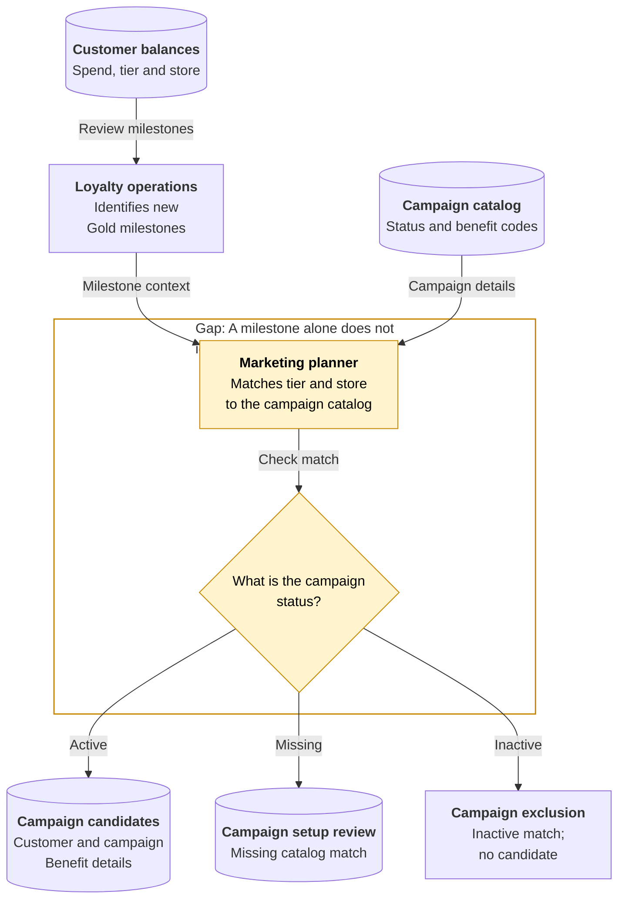
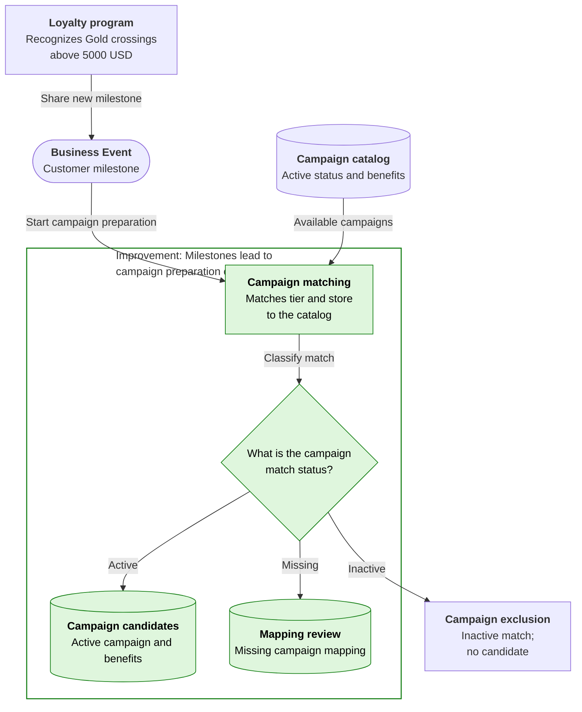
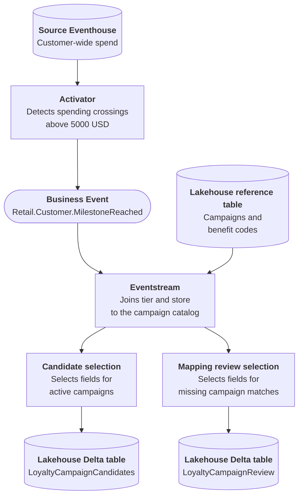

# Customer Loyalty Milestone

## Business Context

The loyalty program maintains customer-wide spending and tier information across stores. Marketing works from a separate campaign catalog that identifies which campaigns are available for each tier and store, whether they are active and which benefits they offer. A customer's progress through the program and the availability of a local campaign are different business facts.

For the current process in this scenario, loyalty operations identifies a new Gold milestone and marketing prepares the campaign candidates. A planner must match the customer's tier and store to the catalog, exclude inactive campaigns and keep missing matches available for review. This is more than exporting customers above a spending threshold: a spending list alone does not tell marketing which campaign it can prepare, and an unresolved catalog entry must not look like a customer ready for outreach.

## Current Problem

A customer passing the Gold spending threshold does not identify a usable campaign. The relevant campaign may be active, inactive or missing from the catalog. A list based on spending alone leaves marketing checking those distinctions or preparing outreach for an unavailable campaign.

Missing campaign mappings also need a visible review path rather than disappearing into the same list. Continued spending above the threshold should not be mistaken for a new milestone.

## Business Events

A qualifying crossing above 5000 USD is shared as a customer-milestone Business Event. The campaign response combines the milestone's tier and store with campaign and benefit context, producing candidates for active campaigns and a separate review list for missing mappings. Inactive matches produce no candidate.

Marketing gets a specific next step for the milestone instead of an undifferentiated spending list. Campaign availability can change without redefining how the loyalty program recognizes progress. The output supports campaign preparation and exception review; it does not issue a reward or authorize customer contact.

## Event-driven architecture {#architecture}

**Business signal:** `Retail.Customer.MilestoneReached`

**Publisher:** Activator | **Consumer(s):** Eventstream (campaign enrichment and Lakehouse Delta tables)

1. Activator monitors supplied customer-wide balances and publishes the milestone when spending crosses above 5000 USD.
2. Eventstream joins the milestone's tier and store to the Lakehouse campaign catalog, adding the matching campaign and benefit details.
3. An active match produces a candidate row; no campaign match produces a mapping-review row. Inactive matches produce neither.
4. The two Lakehouse Delta tables make campaign preparation and missing-mapping review available separately to marketing.

The source Eventhouse holds supplied balances; this exercise does not calculate lifetime spend. No consumer Activator, CRM change, issued reward or delivered communication is part of the outcome.

## Business outcome and boundaries

Prepare one distinct candidate in `LoyaltyCampaignCandidates` and one unmatched customer in `LoyaltyCampaignReview`. Eventstream joins the tier and store to a reference catalog, excludes inactive campaigns and saves useful fields as Lakehouse Delta tables.

**Where the exercise stops:** Exactly 5000 and 4999 do not qualify; continued spending from 5100 to 5200 is not a second crossing. An inactive campaign produces no output. These append tables are not an exactly-once audience or a reward ledger; check contact permission and benefit eligibility before outreach.

## Try the Workbook

The [Workbook](customer-loyalty-milestone/deployment.md){#deploy-this-scenario} brings preparation, connections, sample inputs, expected results and code reference into one place. Follow that single path to explore the outcome above.

