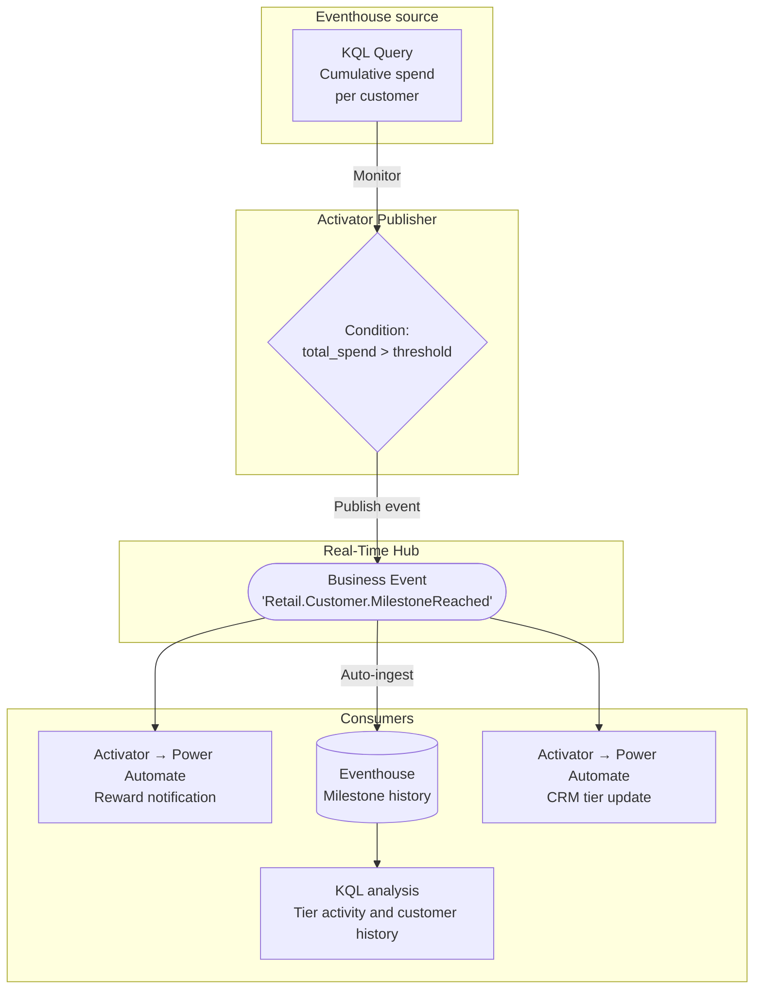

# Customer Loyalty Milestone

**Publisher:** Activator | **Consumers:** Activator, Eventhouse

## Business context

A retail company already tracks cumulative customer spending across stores. When a customer reaches a loyalty milestone, such as $5,000 in spend, marketing needs to issue a reward, analytics needs to record the occurrence, and the CRM needs the new loyalty tier.

Each team owns a different system and response. They need a consistent definition of the milestone without having to reproduce the spending threshold in every application or coordinate every downstream update through the detection rule. Analytics also needs a queryable milestone history to compare tier activity across stores and look up a customer's milestone context.

**The problem without Business Events:**
A shared rule or existing integrations can deliver the first implementation. If detection and all responses are maintained together, adding a team or changing a response requires coordination with the owner of that implementation. Separate detection rules can instead drift in their interpretation of the milestone.

**The solution with Business Events:**
Activator keeps detecting the milestone and publishes a `Retail.Customer.MilestoneReached` event. Marketing and CRM responses use independent Activator rules, and Eventhouse records received events for analytics. Teams can add responses using the existing contract without changing detection; changes to the milestone definition still require agreement.

## Architecture



| Component | Role |
|---|---|
| Source | Eventhouse `transactions` table supplies customer spend; it is not the milestone-history table |
| Publisher | Activator detects the spend threshold crossing and publishes a milestone |
| Consumer 1 | Independent Activator rules invoke marketing and CRM Power Automate flows |
| Consumer 2 | Eventhouse stores the published milestones for analytics |
| Schema set | `RetailCustomers` |
| Event type and KQL table | `Retail.Customer.MilestoneReached` |

## Step 1: Create the Business Event

Before configuring Activator, define the Business Event in Real-Time Hub.

1. Go to [Real-Time Hub → Business Events → Create](https://learn.microsoft.com/en-us/fabric/real-time-hub/business-events/create-business-events).
2. Create or select an Event Schema Set. Use `RetailCustomers` as the schema set name.
3. Name the event `Retail.Customer.MilestoneReached`.
4. In the schema editor, paste the following JSON:

    ```json
    {
      "type": "record",
      "name": "Retail.Customer.MilestoneReached",
      "fields": [
        {
          "name": "customer_id",
          "type": "string",
          "doc": "Unique identifier of the customer"
        },
        {
          "name": "customer_name",
          "type": "string",
          "doc": "Full name of the customer"
        },
        {
          "name": "milestone_tier",
          "type": "string",
          "doc": "Loyalty tier reached: silver, gold, or platinum"
        },
        {
          "name": "total_spend",
          "type": "float",
          "doc": "Cumulative spend amount that triggered this milestone"
        },
        {
          "name": "store_id",
          "type": "string",
          "doc": "Identifier of the store where the milestone was reached"
        },
        {
          "name": "detected_at",
          "type": "string",
          "doc": "Timestamp when the milestone was detected, ISO 8601 format"
        }
      ]
    }
    ```

5. Keep **Analyze in Eventhouse** enabled. Create a new Eventhouse or select an existing one in your workspace. Fabric automatically creates the dedicated `Retail.Customer.MilestoneReached` KQL table. This output table is separate from the `transactions` source table.
6. Select **Create**.

## Step 2: Publisher - Activator

Activator monitors a KQL query that computes cumulative customer spend. When the condition is met, it publishes the Business Event. There is no code to write.

### Create the Activator rule

1. In your Fabric workspace, open your KQL Queryset that queries the customer transaction table in your Eventhouse.
2. Write or select a query that returns cumulative spend per customer, for example:

    ```kusto
    transactions
    | summarize total_spend = sum(amount) by customer_id, customer_name, store_id
    ```

3. Select **Set alert** from the KQL Queryset toolbar.
4. In the Activator rule pane, configure the condition:
    - **Monitor**: select the query result field `total_spend`
    - **Condition**: `Becomes greater than`
    - **Value**: `5000`

Keep below-threshold customers in the query results so the publisher rule can observe a transition from at or below `5000` to above it. This sample evaluates spend per customer and store and maps the crossing to the `gold` tier.

### Configure the publish action

5. In the **Action** section, select **Publish a business event**.
6. For **Business event**, select `Retail.Customer.MilestoneReached`.
7. Map each schema field to the corresponding query result column or a static value:

    | Schema field | Source |
    |---|---|
    | `customer_id` | `customer_id` column |
    | `customer_name` | `customer_name` column |
    | `milestone_tier` | Static value: `gold` |
    | `total_spend` | `total_spend` column |
    | `store_id` | `store_id` column |
    | `detected_at` | Dynamic: current timestamp |

8. Select **Save** to activate the rule.

For full details on using Activator as a Business Events publisher, see the [Activator publisher documentation](https://learn.microsoft.com/en-us/fabric/real-time-hub/business-events/business-events-activator).

## Step 3: Consumer 1 - Marketing reward (Activator → Power Automate)

1. In Real-Time Hub, locate `Retail.Customer.MilestoneReached` under your schema set.
2. Select **Set alert**.
3. Name the rule `Loyalty Milestone - Reward`.
4. In the **Monitor** section, set **Source** to **Business events** and connect to `Retail.Customer.MilestoneReached`.
5. Set **Condition** to `On each event`.
6. In the **Action** section, select **Power Automate** and connect the flow that sends the reward notification.
7. Add `customer_id`, `customer_name`, and `milestone_tier` as context fields.
8. Select **Save**.

## Step 4: Consumer 2 - Analytics (Eventhouse)

The Eventhouse consumer was enabled in Step 1. It receives the published milestone independently of the marketing and CRM rules. No separate ingestion configuration or custom table name is needed.

Open the selected Eventhouse KQL database and query the automatically created `Retail.Customer.MilestoneReached` table. Use bracket syntax because the table name preserves dots.

**Inspect the latest milestone events:**

```kusto
['Retail.Customer.MilestoneReached']
| order by ingestion_time() desc
| take 50
```

**Compare milestone activity by store and tier:**

```kusto
['Retail.Customer.MilestoneReached']
| where ingestion_time() > ago(30d)
| summarize ReceivedMilestones = count(),
    Customers = dcount(customer_id) by store_id, milestone_tier
| order by ReceivedMilestones desc
```

**Look up a test customer's milestone history:**

```kusto
['Retail.Customer.MilestoneReached']
| where customer_id == "cust-loyalty-demo-001"
| project DetectedAt = todatetime(detected_at), ReceivedAt = ingestion_time(),
    customer_id, milestone_tier, total_spend, store_id
| order by DetectedAt desc
```

This table records milestone signals, not every purchase, successful reward delivery, or completed CRM updates. Repeated publications or deliveries can increase event counts. Measuring reward redemption or CRM completion requires outcomes from those systems.

Use the tier-activity query in a Real-Time Dashboard for marketing and store operations. See [Eventhouse and Business Events integration](https://learn.microsoft.com/en-us/fabric/real-time-hub/business-events/business-events-eventhouse) for dashboard setup.

## Step 5: Consumer 3 - CRM tier update (Activator → Power Automate)

Repeat the same steps as Consumer 1 with a different Power Automate flow:

1. In Real-Time Hub, locate `Retail.Customer.MilestoneReached`.
2. Select **Set alert**.
3. Name the rule `Loyalty Milestone - CRM Update`.
4. Set **Condition** to `On each event`.
5. Connect the Power Automate flow that updates the customer's loyalty tier in the CRM.
6. Add `customer_id` and `milestone_tier` as context fields.
7. Select **Save**.

## Step 6: End-to-end test

Use synthetic customer transactions in your test workspace to produce a real threshold crossing. Running the KQL query alone does not publish an event; the saved Activator publisher rule must evaluate the changed result.

1. Prepare source transactions for a new test customer, for example `cust-loyalty-demo-001` at `store-mx-042`, totaling `4900`. Keep `customer_name` consistent between records. Use a new customer ID for each test run.
2. Let the Activator publisher evaluate the below-threshold result. Confirm that no milestone is published for this test customer yet.
3. Add a `200` transaction for that customer and store through your test data source. The query now returns `5100`.
4. Let the publisher evaluate the changed result. In Real-Time Hub, open `Retail.Customer.MilestoneReached`, confirm that the publisher rule is listed on the **Publisher** tab, and verify the customer ID, `gold` tier, and `5100` spend in **Data preview**.
5. Confirm that the marketing Power Automate flow runs and sends the reward notification.
6. Run the customer-history query from Step 4. Confirm that the Eventhouse table contains the same customer ID, tier, spend, and store as the published event.
7. Confirm separately that the CRM Power Automate flow runs and updates the tier.

The test is complete only when both Activator response flows and the Eventhouse history are verified. A row in the history table proves analytical delivery of the milestone; it does not prove that either Power Automate flow completed.

## Why this matters

Each team controls its own consumer. Marketing can update the reward flow without involving analytics or CRM. Analytics can change queries and dashboards over the milestone-history table without touching the detection rule. A customer success team can add a Teams notification through another Activator rule using the same contract. The Eventhouse source query remains responsible for spend calculations; the separate history table records the milestones the publisher emits.
