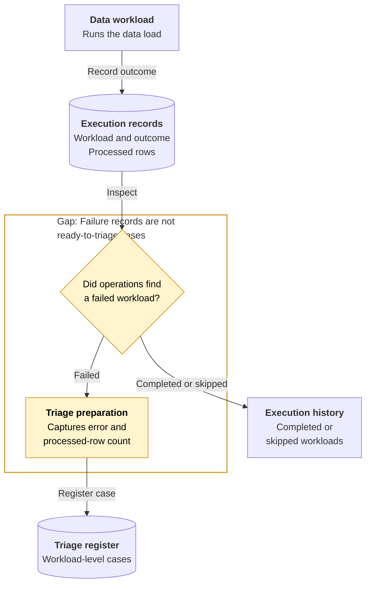
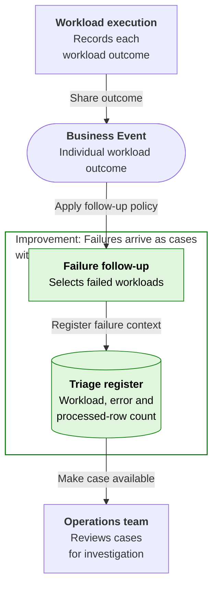
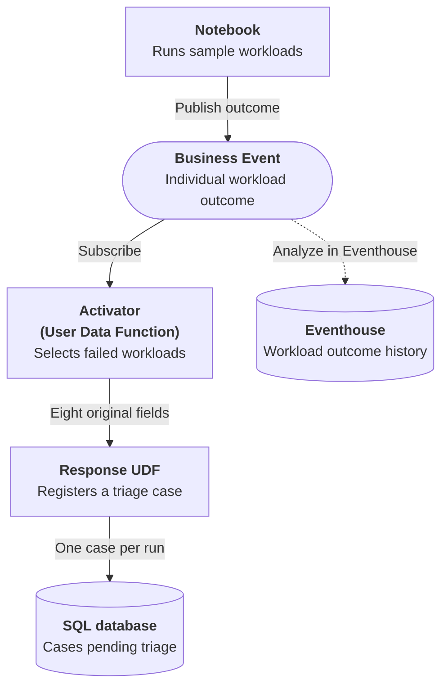

# Data Pipeline Failure Follow-up

## Business Context

Data operations runs workloads and inspects execution records to understand which loads completed, which were skipped and which failed. The records contain the workload identity, outcome, processed-row count and failure context. A successful load can legitimately contain no rows, while a failed load may already have processed part of its input.

In the current workflow here, an operator reviews those records, identifies a failed workload and prepares a case for the team responsible for investigation. The case needs the individual workload's context, not just the overall job status or a generic failure message. Until the error and progress are carried into the triage register, the next person must reconstruct what happened. Completed and deliberately skipped work should remain visible without creating competing incident work.

## Current Problem

Execution history is a record of what happened, not a ready-made triage queue. If failures stay only in that history, someone must collect the workload identity and progress before handing the problem to the next person.

Treating every outcome as an incident creates the opposite problem: successful empty loads and intentional skips compete with failures for attention. The business needs actionable follow-up without losing the detail of partial progress.

## Improved Business Response {#business-events}

The follow-up response selects failed workload outcomes and creates a case containing the workload identity, failure context and processed-row count. Each workload outcome is shared as a Business Event. Completed and skipped work does not enter the triage queue.

Operations can begin with a case ready for investigation rather than reconstructing the execution history. The team responsible for follow-up can change how cases are prepared without changing the data workload. Registering the failure is the handoff to triage, not a repair or rerun of the failed work.

## Event-driven architecture {#architecture}

**Business signal:** `DataOps.Pipeline.RunCompleted`

**Publisher:** Notebook | **Consumer(s):** Activator (User Data Function)

1. One Notebook runs the six sample workload attempts and publishes each workload's outcome as a Business Event.
2. Activator selects failed outcomes and starts the response User Data Function. Completed and skipped outcomes do not invoke that response.
3. The function records the two failed workloads as SQL cases, including their partial row counts of 12 and 3, ready for triage.

The Workbook checks the two saved cases and explains which completed and skipped outcomes should be ignored. It does not repair or rerun the failed work.

Dashed arrows show optional event history and its analysis, separate from the required response. **Analyze in Eventhouse** is a creation-time choice, not a connection enabled by the deployment package or a prerequisite for completing the Workbook.

## Business outcome and boundaries

Run one Notebook containing six workload attempts. The two failed outcomes create SQL cases with status `pending_triage`, preserving their partial row counts of 12 and 3.

**Where the exercise stops:** Completed workloads, including the zero-row success, and skipped workloads create no follow-up case. Notebook execution status and individual workload status are different; a completed demonstration does not mean every workload succeeded.

## Try the Workbook

The [Workbook](data-pipeline-failure-follow-up/deployment.md){#deploy-this-scenario} brings preparation, connections, sample inputs, expected results and code reference into one place. Follow that single path to explore the outcome above.

