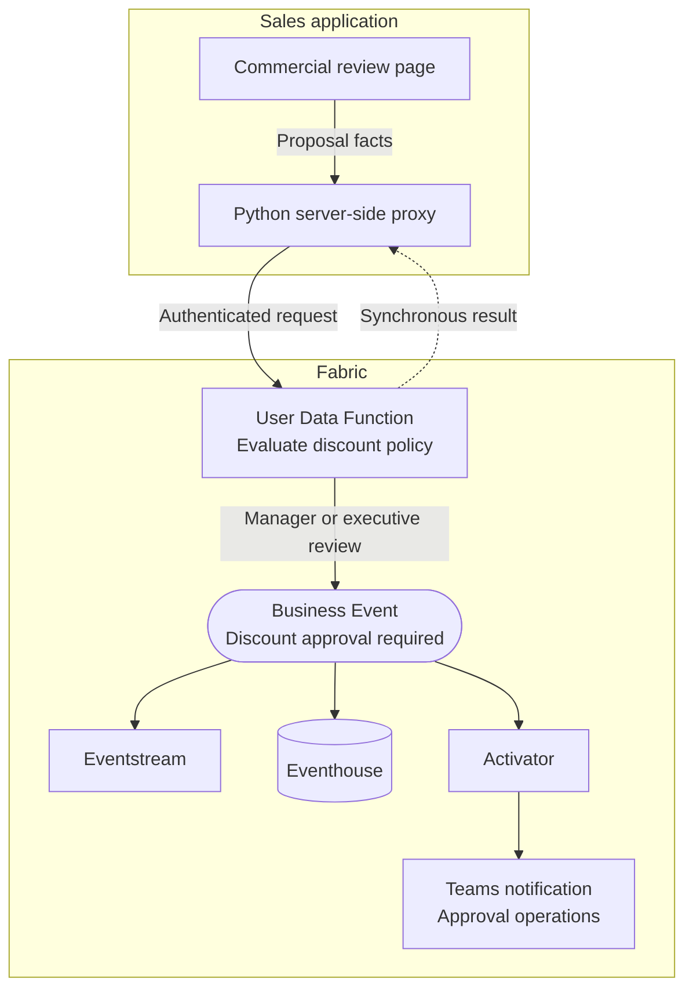

# Discount Approval Evaluation and Event Publication

**Publisher:** User Data Function | **Consumers:** Activator, Eventstream, Eventhouse

## Business context

A sales team already applies commercial policy when negotiating deals. A proposed discount or estimated margin can require manager or executive review. Sellers need an immediate evaluation result, while approval operations and analytics need a consistent representation of the review requirement.

**The problem without Business Events:**
Policy evaluation can already live in a shared service. The scaling challenge is keeping that evaluation separate from each approval, notification, and analytics integration, so new consumers do not require the sales application to reproduce policy or manage another downstream call.

**The solution with Business Events:**
The sales application sends proposal facts to a Fabric User Data Function. The UDF owns policy evaluation, returns the approval level synchronously, and publishes `Sales.Deals.DiscountApprovalRequired` only for manager or executive review. Activator notifies approval operations, while Eventstream and Eventhouse consume the same contract independently for downstream processing and analytics. The event communicates that review is required; it does not mean approval has been granted.

This public sample reuses the demonstrated FabCon code path: a browser application, a server-side Python proxy, Azure CLI delegated authentication for development, and the tested UDF request and response contract. This walkthrough adds a separately configured Activator notification without changing that executable contract. See the [sample README](https://github.com/microsoft/fabric-events/blob/main/samples/user-data-functions/discount-approval-routing/README.md).

## Architecture



The dashed arrow is the synchronous evaluation response. The event path is asynchronous. The proxy uses an Azure CLI delegated token and maps `snake_case` proposal facts to `camelCase` UDF parameters.

| Component | Name | Responsibility |
|---|---|---|
| Sales application | Commercial review page | Collects proposal facts and displays the synchronous result |
| Server-side adapter | Python proxy | Validates input, acquires a development token, maps fields, and invokes the UDF |
| Publisher and policy owner | `DiscountApprovalPublisher` | Evaluates commercial policy and conditionally calls `PublishEvent` |
| Event Schema Set | `CommercialGovernance` | Holds the governed v1 event definition |
| Business Event | `Sales.Deals.DiscountApprovalRequired` | Signals that manager or executive review is required |
| Eventstream | `DiscountApprovalStream` | Receives approval-required events for downstream processing |
| Eventhouse | `DiscountApprovalAnalytics` | Stores approval-required events for analytics |
| Activator | `Discount Review Required` | Sends approval operations the proposal and required review level |

The command and event paths have different success conditions. A successful UDF response can report that publication was requested. It does not prove that an event reached publisher preview, Eventstream, Eventhouse, or another consumer. Verify delivery separately.

## Step 1: Create the Business Event

1. Go to [Real-Time Hub, Business Events, Create](https://learn.microsoft.com/en-us/fabric/real-time-hub/business-events/create-business-events).
2. Select **Create new schema**.
3. Name the event `Sales.Deals.DiscountApprovalRequired`.
4. Create or select the `CommercialGovernance` Event Schema Set.
5. Paste the exact demonstrated v1 schema:

    ```json
    {
      "type": "record",
      "name": "Sales.Deals.DiscountApprovalRequired",
      "fields": [
        {
          "name": "deal_id",
          "type": "string",
          "doc": "Unique identifier of the proposal"
        },
        {
          "name": "account_name",
          "type": "string",
          "doc": "Customer account associated with the proposal"
        },
        {
          "name": "region",
          "type": "string",
          "doc": "Sales region responsible for the proposal"
        },
        {
          "name": "deal_value",
          "type": "double",
          "doc": "Total commercial value of the proposal"
        },
        {
          "name": "requested_discount_percent",
          "type": "double",
          "doc": "Discount percentage requested by the seller"
        },
        {
          "name": "estimated_margin_percent",
          "type": "double",
          "doc": "Estimated margin after applying the requested discount"
        },
        {
          "name": "approval_level",
          "type": "string",
          "doc": "Required approval authority: manager or executive"
        },
        {
          "name": "approval_reason",
          "type": "string",
          "doc": "Discount rule that triggered the approval request"
        },
        {
          "name": "event_time",
          "type": "string",
          "doc": "UTC time when the proposal was evaluated, ISO 8601 format"
        }
      ]
    }
    ```

6. Leave **Analyze in Eventhouse** enabled and select or create `DiscountApprovalAnalytics`.
7. Review the event name, schema set, workspace, and Eventhouse, then select **Create**.

The downloadable [`discount-approval-event-schema.avsc`](https://github.com/microsoft/fabric-events/blob/main/samples/user-data-functions/discount-approval-routing/discount-approval-event-schema.avsc) contains the same nine fields. The UDF publishes with `data_version="v1"`.

Do not add `evaluation_id` silently to this schema. If repeated revisions need a stable correlation and idempotency key, create an explicit schema v2 with an immutable `evaluation_id` and migrate producers and consumers deliberately.

## Step 2: Publisher - User Data Function

### Policy paths

| Path | Condition | Synchronous result | Business Event |
|---|---|---|---|
| Within policy | Discount is at most 10% and margin is at least 25% | `approval_level: none` | Not published |
| Manager approval | Discount is greater than 10% and at most 15%, and margin is at least 25% | `approval_level: manager` | Publication requested |
| Executive approval | Discount is greater than 15% or margin is below 25% | `approval_level: executive` | Publication requested |

The executive rule takes precedence. A 12% discount with a 24% margin requires executive approval.

### Create and connect the User Data Function

1. In the Fabric workspace, create a User Data Function named `DiscountApprovalPublisher`.
2. Open the UDF item.
3. In **Home**, select **Manage connections**.
4. Select **Add connection**.
5. Search for `CommercialGovernance` and select it.
6. Copy the generated alias into the `@udf.connection` decorator.
7. Copy the complete sample from [`evaluate_discount_request.py`](https://github.com/microsoft/fabric-events/blob/main/samples/user-data-functions/discount-approval-routing/evaluate_discount_request.py) into the UDF editor.

The executable sample preserves the demonstrated policy rules, event type, nine payload fields, `data_version="v1"`, and return fields:

```python
return {
    "approval_level": approval_level,
    "event_published": True,
    "message": (
        f"Deal {dealId} requires {approval_level} approval. "
        "Business Event published."
    ),
}
```

It adds public-sample validation without changing the policy or payload contract:

- Non-empty string and length validation for `dealId`, `accountName`, and `region`
- Finite and range validation for deal value, discount, and margin
- Time-zone-aware UTC validation for `eventTime`

### Connect the sales application

The companion sample contains the [browser app](https://github.com/microsoft/fabric-events/blob/main/samples/user-data-functions/discount-approval-routing/index.html) and [Python proxy](https://github.com/microsoft/fabric-events/blob/main/samples/user-data-functions/discount-approval-routing/server.py).

The browser sends the demonstrated snake_case request:

```json
{
  "deal_id": "DEAL-2048",
  "account_name": "Sample Health",
  "region": "West",
  "deal_value": 450000.0,
  "requested_discount_percent": 18.0,
  "estimated_margin_percent": 22.0,
  "event_time": "2026-09-15T17:15:00Z"
}
```

The proxy maps it explicitly to the exact UDF parameters:

| Application field | UDF parameter |
|---|---|
| `deal_id` | `dealId` |
| `account_name` | `accountName` |
| `region` | `region` |
| `deal_value` | `dealValue` |
| `requested_discount_percent` | `requestedDiscountPercent` |
| `estimated_margin_percent` | `estimatedMarginPercent` |
| `event_time` | `eventTime` |

Publish the UDF, enable its public URL, and grant the developer Execute permission. Then authenticate with Azure CLI and start the sample:

```powershell
az login
python server.py --mode fabric --udf-url "<public UDF URL>"
```

The public UDF URL is supplied only at startup. It is not stored in browser code or committed. The proxy acquires a delegated development token server-side for:

```text
https://analysis.windows.net/powerbi/api/user_impersonation
```

Azure CLI delegated authentication is the demonstrated developer path. It is not a production identity design. Production hosting must use an approved, configurable identity and token lifecycle. Tokens must never be logged or exposed to the browser.

The proxy uses the demonstrated 120-second timeout by default. Use `--timeout` to configure it. If token acquisition or Fabric invocation fails, the proxy returns a clear error and does not fall back to local simulation.

### Parse the Fabric response

The proxy applies the empirically supported response behavior:

- `status` must equal `Succeeded`.
- `errors` supplies failure details.
- `output` can be a JSON object or a JSON string.
- `approval_level`, `event_published`, and `message` are required.
- Additional envelope and output fields are tolerated.
- `invocationId` is optional and is preserved as `invocation_id` when present.

The application normalizes `event_published` to `publication_requested`. This label is intentionally narrower. A true value means `PublishEvent` returned during UDF execution. It does not confirm downstream delivery.

For explicit fallback testing only:

```powershell
python server.py --mode local
```

Local simulation applies the same policy but never calls Fabric and always reports `publication_requested: false`.

## Step 3: Consumers

### Consumer 1: Eventstream

1. Open `Sales.Deals.DiscountApprovalRequired` in Real-Time Hub.
2. Select **Add consumer**, then **Eventstream**.
3. Select the target workspace.
4. Name the Eventstream `DiscountApprovalStream`.
5. Review the configuration and select **Connect**.
6. Open the Eventstream and use Data preview to confirm approval-required events arrive.

Eventstream receives only manager and executive paths. It does not receive the within-policy synchronous result.

### Consumer 2: Eventhouse

Because **Analyze in Eventhouse** was enabled, Fabric creates the KQL table automatically.

```kusto
['Sales.Deals.DiscountApprovalRequired']
| where ingestion_time() > ago(24h)
| project
    event_time,
    deal_id,
    account_name,
    region,
    deal_value,
    requested_discount_percent,
    estimated_margin_percent,
    approval_level,
    approval_reason
| order by event_time desc
```

These rows represent published exceptions only. They cannot calculate the share of all proposals that were within policy unless another governed dataset records the full proposal population.

### Consumer 3: Activator notification

1. In Real-Time Hub, locate `Sales.Deals.DiscountApprovalRequired` under `CommercialGovernance`.
2. Select **Set alert** and name the rule `Discount Review Required`.
3. In **Monitor**, select **Business events** and connect to that event.
4. Set **Condition** to `On each event`. The UDF has already evaluated the discount and margin policy.
5. In **Action**, select **Teams**, then **Channel post**, and choose the approval operations channel.
6. Include `deal_id`, `approval_level`, `approval_reason`, and `region` as context. Use the existing proposal system to look up additional details rather than posting unnecessary customer data.
7. Save the rule.

This consumer notifies the team that review is required. It does not assign an approver or capture an approval decision. Eventhouse ingestion and Eventstream delivery do not depend on the notification completing.

## Step 4: End-to-end test

Run the automated sample tests:

```powershell
python -m unittest -v
```

The tests cover exact field mapping, policy boundaries, validation, Fabric status and errors, object and string outputs, optional diagnostics, 120-second and configured timeouts, Azure CLI failures, no automatic fallback, and local plus mocked Fabric HTTP paths. Automated tests do not require a real endpoint.

For an optional live call, use the sanitized [`verify_live.py`](https://github.com/microsoft/fabric-events/blob/main/samples/user-data-functions/discount-approval-routing/verify_live.py):

```powershell
python verify_live.py --udf-url "<public UDF URL>"
```

The script invokes the configured UDF and checks the synchronous executive result. It does not automate a browser or recording workflow.

After a live manager or executive evaluation:

1. Confirm the application shows the expected `approval_level` and `publication_requested: true`.
2. In the Business Event's publisher preview, verify the matching `deal_id`.
3. In `DiscountApprovalStream` Data preview, verify the same event separately.
4. Query `DiscountApprovalAnalytics` and confirm the event fields.
5. Confirm that the Teams notification contains the same `deal_id`, required `approval_level`, and `approval_reason`.
6. Confirm within-policy requests are absent from event consumers and produce no Teams review notification.

The walkthrough is complete only when the synchronous evaluation, Eventstream receipt, Eventhouse row, and Activator notification have each been verified. A successful UDF response alone does not establish downstream delivery.

## What happens next

The executable sample stops at evaluation and event publication request. This walkthrough also configures analytics and a review-required notification. It does not implement:

- Approver assignment
- Approve or reject capture
- SLA timers, reminders, or escalation
- CRM or sales application updates
- Final decision correlation

Extend the notification with an approval workflow and a separate versioned decision contract for those responsibilities. If revision-safe correlation is required, introduce `evaluation_id` in schema v2 and design consumers for idempotency.

Treat `account_name` as customer data. Prefer a pseudonymous identifier when the display name is unnecessary, restrict Eventhouse and Eventstream access to approved roles, and retain the field only for the documented purpose and minimum required period.

For more detail, use the [sample README](https://github.com/microsoft/fabric-events/blob/main/samples/user-data-functions/discount-approval-routing/README.md), [UDF publisher documentation](https://learn.microsoft.com/en-us/fabric/real-time-hub/business-events/business-events-user-data-function), [Eventstream overview](https://learn.microsoft.com/en-us/fabric/real-time-intelligence/event-streams/overview), [schema versioning guidance](../design-guides/schema-versioning.md), and [retry guidance](../design-guides/handling-retries.md).
