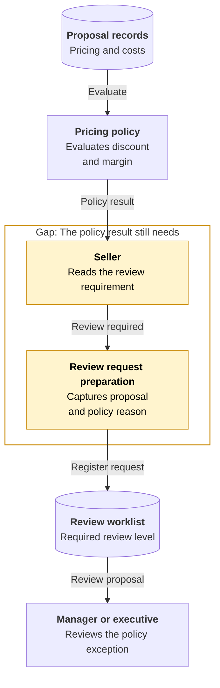
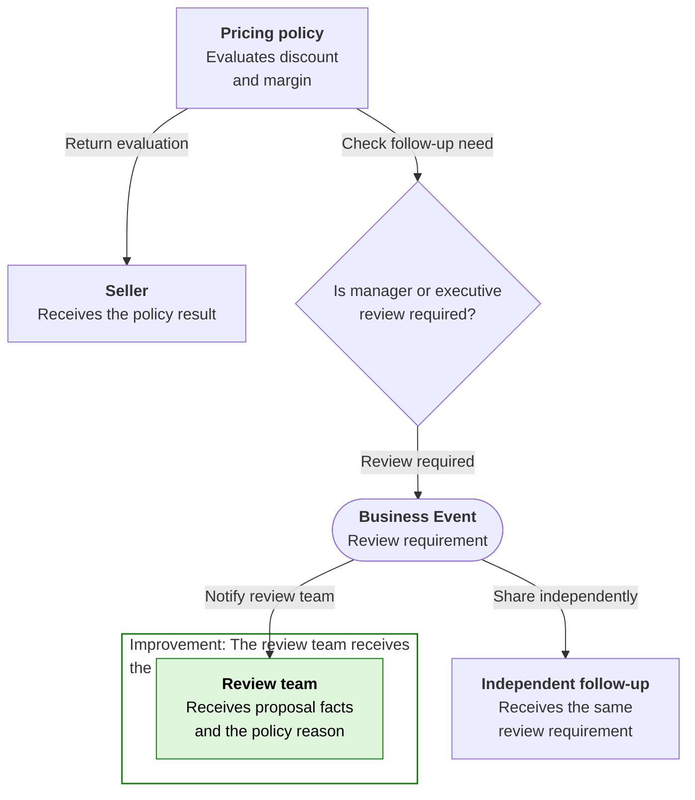
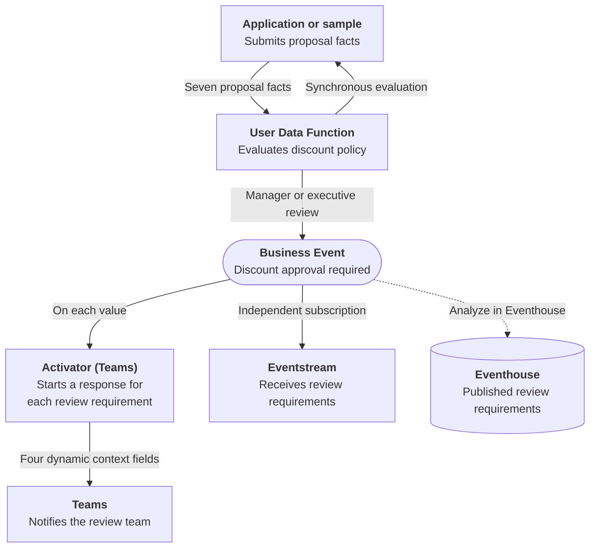

# Discount Approval Evaluation and Event Publication

## Business Context

A seller prepares a commercial proposal using its pricing, discount and cost context. The pricing policy evaluates the requested discount and resulting margin, distinguishing deals within policy from those requiring manager or executive review. The seller receives that evaluation while still working on the proposal.

The operating model here leaves the next step with the seller: when review is needed, the proposal facts and policy reason must be prepared for the review team. The manager or executive needs to understand both the commercial request and why it falls outside the normal policy. A result on the seller's screen is not yet a review request in the team's worklist, and asking the receiving team to calculate the requirement again can produce competing interpretations of the same deal.

## Current Problem

A result visible only to the seller does not bring the proposal to the review team's attention. Copying the details into another channel leaves the team reconstructing why review was requested.

If each follow-up process also interprets the policy separately, the same proposal can acquire different review requirements. The business needs one evaluation to inform both the seller and the people who will consider the exception.

## Improved Business Response {#business-events}

The proposal is evaluated once and the result is returned to the seller. When manager or executive review is required, the same result is shared as a Business Event with the proposal context and reason. Within-policy proposals do not create review notifications.

The seller gets an answer without waiting for every follow-up response, and the review team gets the reasoning it needs rather than another policy to interpret. Other uses of the review requirement can be added independently. The shared result identifies a need for review, not an approval already granted.

## Event-driven architecture {#architecture}

**Business signal:** `Sales.Deals.DiscountApprovalRequired`

**Publisher:** User Data Function | **Consumer(s):** Activator (Teams), Eventstream

1. The User Data Function evaluates the proposal's discount and margin policy and returns the result to the seller's application or sample.
2. Only a manager or executive review requirement is published as a Business Event.
3. Two independent branches receive that result: Activator sends a Teams notification, while Eventstream receives the same review requirement. Neither branch evaluates the pricing policy again or waits for the other branch to finish.

The Workbook uses the prepared proposal sample. Connecting the optional browser application is an extension, not a prerequisite.

Dashed arrows show optional event history and its analysis, separate from the required response. **Analyze in Eventhouse** is a creation-time choice, not a connection enabled by the deployment package or a prerequisite for completing the Workbook.

## Business outcome and boundaries

Evaluate eight proposals: two remain within policy, two require manager review and four require executive review. Make the six review requirements available in Teams and Eventstream with the original nine-field contract.

**Where the exercise stops:** The exercise identifies required review; it does not assign an approver, capture an approval or apply a discount. A synchronous evaluation does not prove that the asynchronous notification or Eventstream delivery completed.

## Try the Workbook

The [Workbook](discount-approval-routing/deployment.md){#deploy-this-scenario} brings preparation, connections, sample inputs, expected results and code reference into one place. Follow that single path to explore the outcome above.

