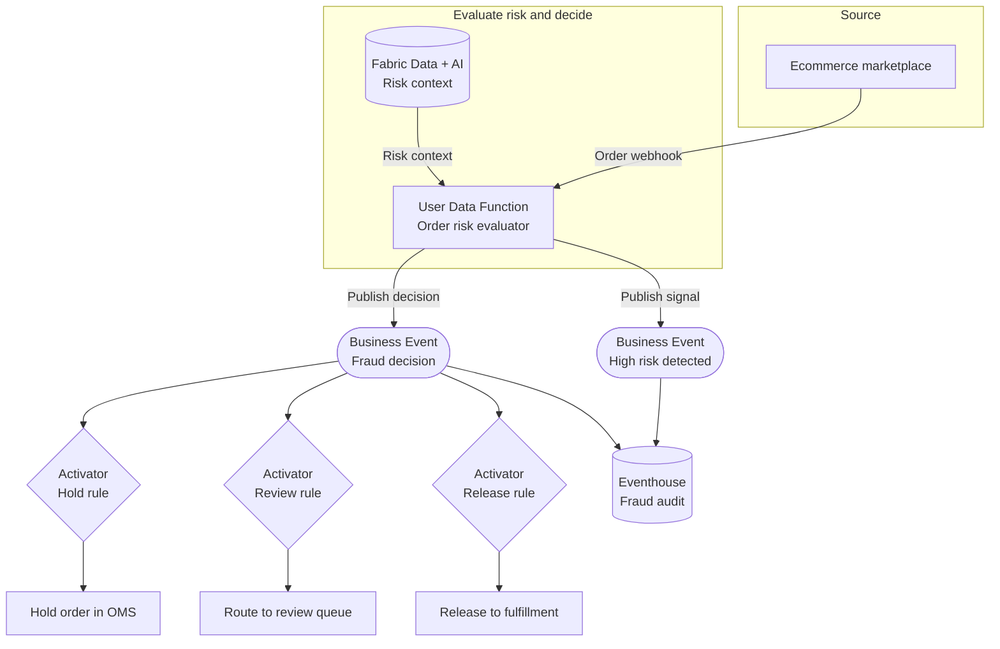
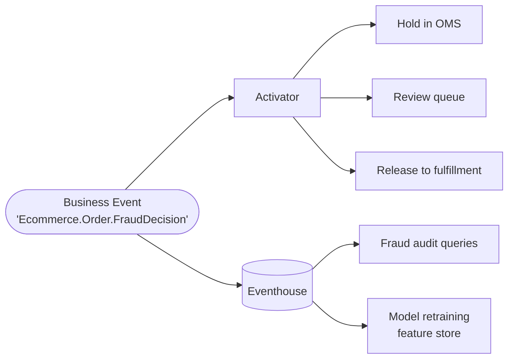

# Fraud Response Before Fulfillment

**Publisher:** User Data Function | **Consumer:** Activator, Eventhouse

## Business context

An ecommerce marketplace already evaluates order risk using customer history, payment metadata, and fraud rules. It needs to hold or review high-risk orders before fulfillment while allowing legitimate purchases to proceed.

A User Data Function receives an order webhook, evaluates the risk score against customer history, payment metadata, and fraud rules stored in Fabric, and publishes two Business Events: `Ecommerce.Order.HighRiskDetected` captures the signal, and `Ecommerce.Order.FraudDecision` carries the decision outcome (hold, manual review, or release). Three independent Activator rules act on the decision. Eventhouse stores the full audit trail for compliance and pattern analysis.

**The problem without Business Events:**
Risk evaluation can already run in a function or application. If each downstream system receives a separate integration or reproduces the decision logic, changes become harder to coordinate and teams may act on different interpretations of the same assessment.

**The solution with Business Events:**
The function publishes separate contracts for the detected risk and the resulting decision. Activator rules use the decision event for hold, review, or release actions, while Eventhouse supports analysis of received events. New consumers can reuse these contracts; changes to risk policy still belong in the evaluator.

## Deploy this scenario

**Status: Reference implementation available.** [`cicd/fraud-response-before-fulfillment`](https://github.com/microsoft/fabric-events/tree/main/cicd/fraud-response-before-fulfillment) contains separate `deploy.bat` and `test.bat` launchers, protected Azure backend provisioning, the live-validated decision UDF, native Activator rules and custom actions, real Power Automate flows, Eventhouse assets and external boundary fixtures. The prototype can download the reviewed resource-name configuration.

[Read the native deployment guide and verification scope](fraud-response-before-fulfillment/deployment.md).

!!! warning "Decision-only reference, not a production OMS adapter"
    The reference implements only `Ecommerce.Order.FraudDecision` from the prototype card. This full walkthrough also describes the independent `Ecommerce.Order.HighRiskDetected` signal and Fabric risk context; those are not implicitly implemented by the reference. Two fresh edited-name deployments and three independent six-case runs completed real native flows, Eventhouse delivery and persisted hold/review/release enforcement. Deployment creates no test orders or events; testing remains a separate explicit command.

The decision publisher selects hold, manual review or release. Only the matching custom action must run; publication or a successful local test does not prove that a flow ran or that the order system enforced a hold. The reference verified these effects against an isolated synthetic backend, not a production OMS. Use the complete manual walkthrough below for the broader two-event example, and the deployment guide for the reference's precise scope.

## Architecture



Arrows show data flow. Event publication and consumption are asynchronous. The function publishes the risk signal and decision separately; the diagram does not imply that one event triggers the other. The hold, review, and release rules filter the decision outcome rather than executing all three actions for every event.

| Component | Contract or responsibility |
|---|---|
| Fabric Data + AI | Customer profile, payment history, and fraud rules used by the evaluator |
| User Data Function | Evaluates risk and publishes the signal and decision |
| High risk detected | `Ecommerce.Order.HighRiskDetected` |
| Fraud decision | `Ecommerce.Order.FraudDecision` |
| Activator rules | Route the decision to hold, manual review, or release workflows |
| Eventhouse | Stores received signal and decision events for audit analysis |

## Step 1: Create the Business Events

This scenario uses two Business Events. Create both in Real-Time Hub before writing any function code.

### Event 1: HighRiskDetected

1. Go to [Real-Time Hub → Business Events → Create](https://learn.microsoft.com/en-us/fabric/real-time-hub/business-events/create-business-events).
2. Create or select an Event Schema Set. Use `EcommerceOrders` as the schema set name.
3. Name the event `Ecommerce.Order.HighRiskDetected`.
4. In the schema editor, paste the following JSON:

    ```json
    {
      "type": "record",
      "name": "Ecommerce.Order.HighRiskDetected",
      "fields": [
        {
          "name": "order_id",
          "type": "string",
          "doc": "Unique identifier of the order under review"
        },
        {
          "name": "customer_id",
          "type": "string",
          "doc": "Identifier of the customer who placed the order"
        },
        {
          "name": "risk_score",
          "type": "float",
          "doc": "Computed fraud risk score between 0.0 (low) and 1.0 (high)"
        },
        {
          "name": "amount",
          "type": "float",
          "doc": "Total order amount in the store local currency"
        },
        {
          "name": "payment_method",
          "type": "string",
          "doc": "Payment method: credit_card, debit_card, or digital_wallet"
        },
        {
          "name": "detected_at",
          "type": "string",
          "doc": "ISO 8601 timestamp of when the risk condition was detected"
        }
      ]
    }
    ```

5. Confirm that **Analyze in Eventhouse** is enabled. Select **Create**.

### Event 2: FraudDecision

1. In the same Event Schema Set (`EcommerceOrders`), select **+ New event**.
2. Name the event `Ecommerce.Order.FraudDecision`.
3. In the schema editor, paste the following JSON:

    ```json
    {
      "type": "record",
      "name": "Ecommerce.Order.FraudDecision",
      "fields": [
        {
          "name": "order_id",
          "type": "string",
          "doc": "Unique identifier of the order"
        },
        {
          "name": "customer_id",
          "type": "string",
          "doc": "Identifier of the customer who placed the order"
        },
        {
          "name": "risk_score",
          "type": "float",
          "doc": "Fraud risk score used to make this decision"
        },
        {
          "name": "decision",
          "type": "string",
          "doc": "Decision outcome: hold, manual_review, or release"
        },
        {
          "name": "decided_at",
          "type": "string",
          "doc": "ISO 8601 timestamp of when the decision was made"
        }
      ]
    }
    ```

4. Enable **Analyze in Eventhouse** and select **Create**.

## Step 2: Publisher - User Data Function

The User Data Function evaluates each order, makes a risk decision, and publishes both Business Events.

### Create the User Data Function

1. In your Fabric workspace, select **+ New item** and create a **User Data Function** named `EvaluateHighRiskOrder`.
2. Inside the UDF item, select **New function**.

### Connect to the schema set

3. In the **Home** ribbon, select **Manage connections**.
4. Select **+ Add connection**, search for `EcommerceOrders`, and select **Connect**.
5. Note the alias (`EcommerceOrders` by default). Close the pane.

### Function code

```python
import fabric.functions as fn
from datetime import datetime, timezone
import logging

udf = fn.UserDataFunctions()

@udf.connection(argName='businessEventsClient', alias='EcommerceOrders')
@udf.function()
def evaluate_high_risk_order(
    businessEventsClient: fn.FabricBusinessEventsClient,
    order_id: str,
    customer_id: str,
    risk_score: float,
    amount: float,
    payment_method: str
) -> str:
    logging.info("evaluate_high_risk_order invoked.")

    detected_at = datetime.now(timezone.utc).isoformat()

    # Publish the signal event — consumers can react to the raw detection
    businessEventsClient.PublishEvent(
        type='Ecommerce.Order.HighRiskDetected',
        event_data={
            'order_id': order_id,
            'customer_id': customer_id,
            'risk_score': risk_score,
            'amount': amount,
            'payment_method': payment_method,
            'detected_at': detected_at,
        },
        data_version='v1'
    )

    # Decision logic — thresholds can be loaded from Lakehouse or SQL DB
    if risk_score >= 0.85:
        decision = 'hold'
    elif risk_score >= 0.55:
        decision = 'manual_review'
    else:
        decision = 'release'

    # Publish the decision event — downstream consumers act on this independently
    businessEventsClient.PublishEvent(
        type='Ecommerce.Order.FraudDecision',
        event_data={
            'order_id': order_id,
            'customer_id': customer_id,
            'risk_score': risk_score,
            'decision': decision,
            'decided_at': datetime.now(timezone.utc).isoformat(),
        },
        data_version='v1'
    )

    return f"Order {order_id}: decision = {decision}"
```

For full details on publishing Business Events from User Data Functions, see the [User Data Function publisher documentation](https://learn.microsoft.com/en-us/fabric/real-time-hub/business-events/business-events-user-data-function).

## Step 3: Consumers

### Consumer 1 - Activator: Hold order

1. In Real-Time Hub, locate `Ecommerce.Order.FraudDecision`.
2. Select **Set alert** and name the rule `Fraud - Hold Order`.
3. Set **Condition** to `On each event`. Add filter: `decision == hold`.
4. In **Action**, configure the Power Automate flow or webhook that places the order on hold in your order management system. Add `order_id` and `risk_score` as context fields.
5. Select **Save**.

### Consumer 2 - Activator: Route to manual review

1. Locate `Ecommerce.Order.FraudDecision` and select **Set alert**.
2. Name the rule `Fraud - Manual Review`. Add filter: `decision == manual_review`.
3. In **Action**, configure the workflow that routes the order to the fraud review queue. Add `order_id`, `customer_id`, and `risk_score` as context fields.
4. Select **Save**.

### Consumer 3 - Activator: Release order

1. Locate `Ecommerce.Order.FraudDecision` and select **Set alert**.
2. Name the rule `Fraud - Release`. Add filter: `decision == release`.
3. In **Action**, configure the webhook that resumes order fulfillment. Add `order_id` as context.
4. Select **Save**.

### Consumer 4 - Eventhouse: Fraud audit trail

Both events are ingested automatically. Use the following queries to monitor decision patterns.

**Decision distribution by payment method — last 30 days:**

```kusto
['Ecommerce.Order.FraudDecision']
| where ingestion_time() > ago(30d)
| summarize Orders = count() by decision, payment_method
| order by Orders desc
```

**Risk score distribution over time:**

```kusto
['Ecommerce.Order.HighRiskDetected']
| where ingestion_time() > ago(7d)
| summarize AvgRisk = avg(risk_score), OrderCount = count()
  by bin(ingestion_time(), 1h)
| order by ingestion_time() asc
```

**Hold rate by payment method:**

```kusto
['Ecommerce.Order.FraudDecision']
| where ingestion_time() > ago(30d)
| summarize
    Total = count(),
    Held = countif(decision == 'hold')
  by payment_method
| extend HoldRate = round(todouble(Held) / Total * 100, 1)
| order by HoldRate desc
```

## Step 4: End-to-end test

Invoke `evaluate_high_risk_order` with the following test values:

| Parameter | Value |
|---|---|
| `order_id` | `ord-44219` |
| `customer_id` | `cust-882` |
| `risk_score` | `0.91` |
| `amount` | `340.00` |
| `payment_method` | `credit_card` |

A `risk_score` of `0.91` exceeds the `0.85` threshold, so the expected decision is `hold`. Confirm both events arrived:

```kusto
['Ecommerce.Order.FraudDecision']
| where order_id == "ord-44219"
| project order_id, decision, risk_score, decided_at
| take 1
```

If the row shows `decision = hold` and the Hold Order Activator rule fires, your setup is working.

## What happens next

The two-event pattern — signal first, decision second — lets different consumers subscribe at different stages of the pipeline without coupling them together.



| Extension | What it enables |
|---|---|
| **Hold / Review / Release** | Independent Activator rules per decision outcome |
| **Fraud audit queries** | Full decision history with risk scores and payment context |
| **Model retraining** | Historical decision events as labeled training data for the fraud model |
| **Compliance report** | Export the audit trail for regulatory requirements |
