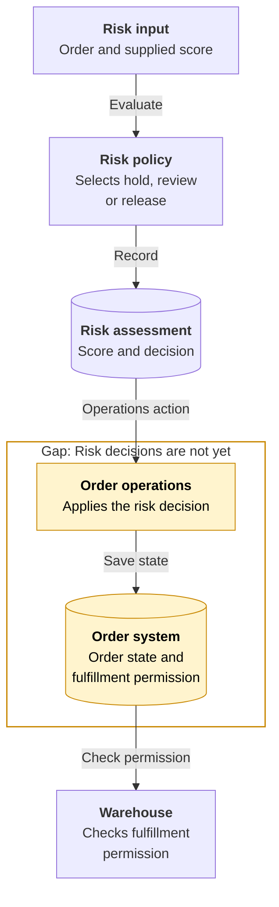
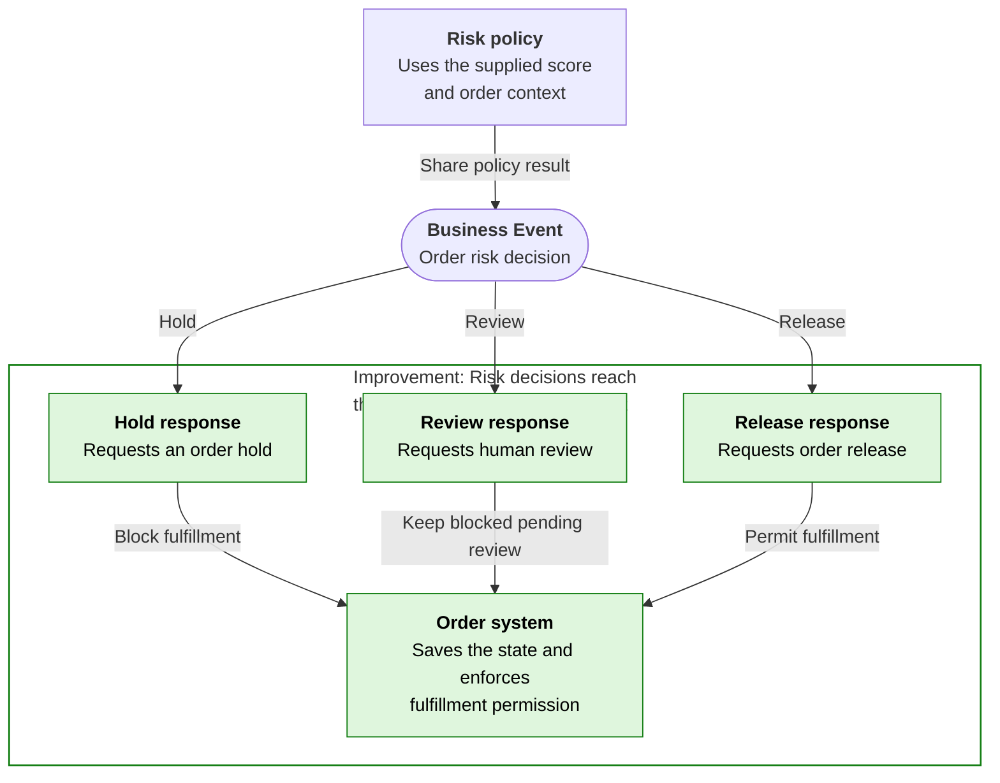
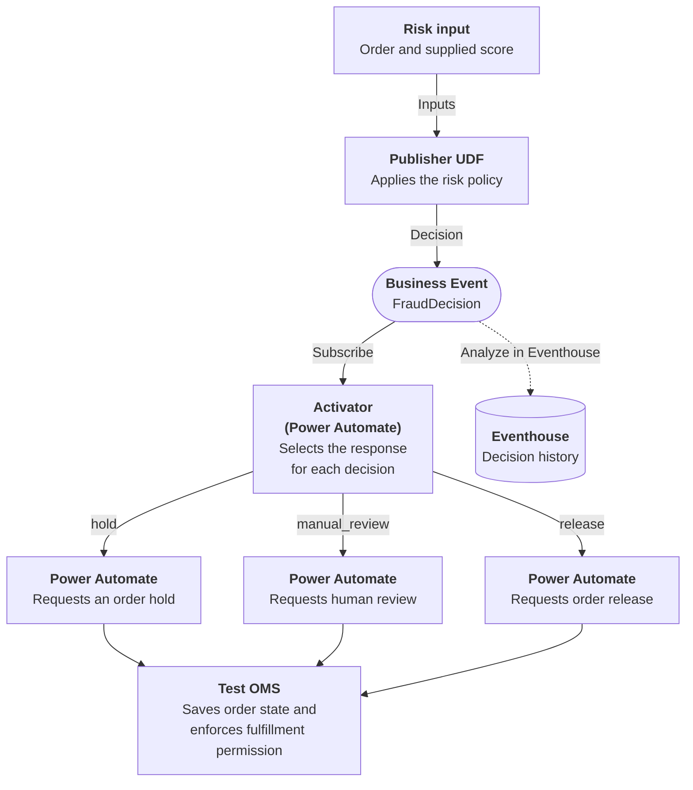

# Fraud Response Before Fulfillment

## Business Context

An online retailer receives orders and scores from an existing risk-scoring process. Its policy uses the supplied score and order context to determine whether an order can be released, needs human review or should be held. The warehouse, however, follows the fulfillment permission saved in the order system rather than the separate risk assessment.

In the current process described here, order operations must take the recorded policy decision and apply it to the order before the warehouse can rely on it. Risk review and fulfillment can therefore be looking at different records of the same order. A warning that has reached a person is not equivalent to a hold that the warehouse enforces, and requesting a review does not mean that a reviewer has cleared the order for release.

## Current Problem

A risk decision recorded separately from order operations may leave fulfillment permission unchanged. Sending a warning does not prevent an order from proceeding, and a request for human review must not be mistaken for a completed review.

The missing connection is from the policy decision to an actual order-state change, with distinct handling for hold, review and release.

## Business Events

The risk-policy result is published as a Business Event for the order. The relevant connected response applies a hold, requests review or releases the order. The order system saves that result and enforces the corresponding fulfillment permission.

This makes the policy useful at the point where operational behavior changes: released orders can proceed, while held and review-requested orders remain blocked. Business Events carries the decision to that response; it does not replace the connected order system or perform the human review.

## Event-driven architecture {#architecture}

**Business signal:** `Ecommerce.Order.FraudDecision`

**Publisher:** User Data Function | **Consumer(s):** Activator (Power Automate: hold, review and release)

1. The publishing User Data Function applies the risk policy to the supplied score and order context, then publishes the decision as a Business Event.
2. Activator selects the decision's hold, review or release response and invokes the corresponding Power Automate flow.
3. The connected test order system persists the requested state and enforces fulfillment permission. A delivered event or flow invocation is not a substitute for this order-system result.

The Workbook checks the saved order states and fulfillment behavior separately from event delivery.

Dashed arrows show optional event history and its analysis, separate from the required response. **Analyze in Eventhouse** is a creation-time choice, not a connection enabled by the deployment package or a prerequisite for completing the Workbook.

## Business outcome and boundaries

Apply six supplied scores to six synthetic orders: two releases, two review requests and two holds. The connected test order system permits fulfillment only for released orders and keeps held or review-requested orders blocked.

**Where the exercise stops:** A supplied score is not proof of fraud. `review_requested` is not `review_completed`. You must supply an authenticated, isolated test order system and connect the three real responses; the package does not deploy an order backend.

## Try the Workbook

The [Workbook](fraud-response-before-fulfillment/deployment.md){#deploy-this-scenario} brings preparation, connections, sample inputs, expected results and code reference into one place. Follow that single path to explore the outcome above.

