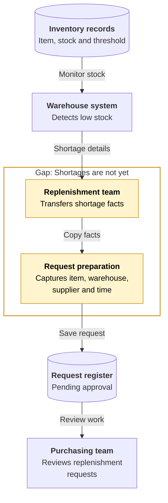
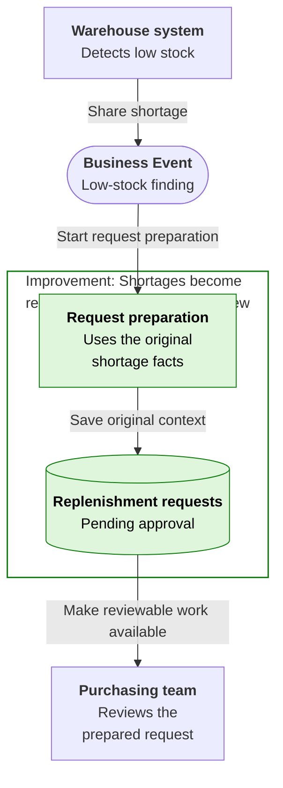
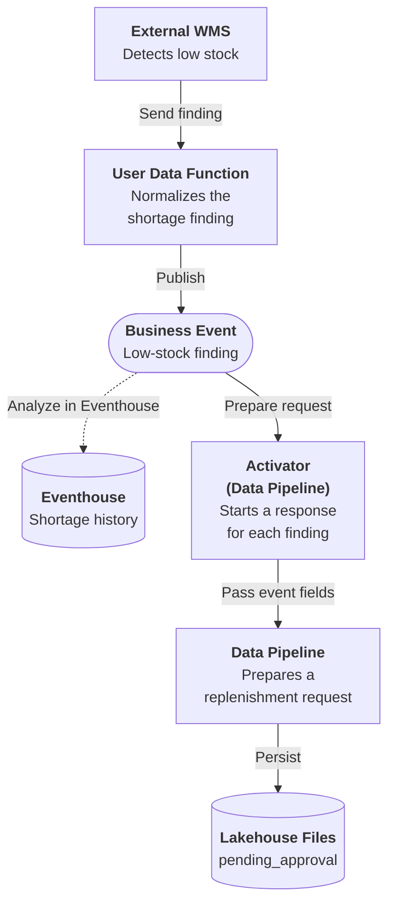

# Low Stock Threshold

## Business Context

The warehouse management system tracks available stock and identifies items below their replenishment threshold. Its shortage record already contains the item, warehouse, observed stock, threshold and supplier context. Warehouse operations owns that finding; the replenishment team owns deciding what purchasing response should follow.

Here, a replenishment coordinator takes the shortage details from the warehouse system and prepares a request for the purchasing team. The reviewer needs the original stock position and observation time to understand why the request exists. Until that request is recorded, a shortage can be visible to the warehouse without being present in the approval queue. Copying the facts does not replenish stock, but it determines whether the purchasing decision is ready to be made.

## Current Problem

A shortage can be visible in the warehouse system without a corresponding request being ready for replenishment to review. When the details must be transferred separately, the team first reconstructs the finding instead of assessing the response.

Repeating the stock check in the request process also creates two places to interpret the shortage policy. The missing step is preparing reviewable work from a finding that the warehouse has already made.

## Improved Business Response {#business-events}

Each low-stock finding starts preparation of a saved replenishment request using the original item, location and stock context. The request is available for approval rather than remaining a shortage observation in another system. The warehouse finding is shared as a low-stock Business Event.

Replenishment can focus on the next purchasing decision instead of re-entering the details. The warehouse keeps its established detection policy, while the team can change how it prepares requests without introducing another stock test.

## Event-driven architecture {#architecture}

**Business signal:** `Retail.Inventory.LowStockThreshold`

**Publisher:** User Data Function | **Consumer(s):** Activator (Data Pipeline)

1. The external warehouse system detects low stock. The publishing User Data Function normalizes and shares that finding without detecting the shortage again.
2. Activator receives the Business Event and starts the Data Pipeline with the original stock facts.
3. The pipeline saves a replenishment request in Lakehouse Files for approval review.

The request is saved as JSON in Lakehouse Files, not as a Delta table.

Dashed arrows show optional event history and its analysis, separate from the required response. **Analyze in Eventhouse** is a creation-time choice, not a connection enabled by the deployment package or a prerequisite for completing the Workbook.

## Business outcome and boundaries

Prepare three saved replenishment requests with status `pending_approval`. Each request preserves the item, warehouse, stock level, threshold and observation time supplied by the source.

**Where the exercise stops:** This exercise does not approve purchases, calculate an order quantity or replenish stock. The threshold is context for review, not a recommended purchase quantity; neither the publishing function nor the response runs a second stock test.

## Try the Workbook

The [Workbook](low-stock-threshold/deployment.md){#deploy-this-scenario} brings preparation, connections, sample inputs, expected results and code reference into one place. Follow that single path to explore the outcome above.

