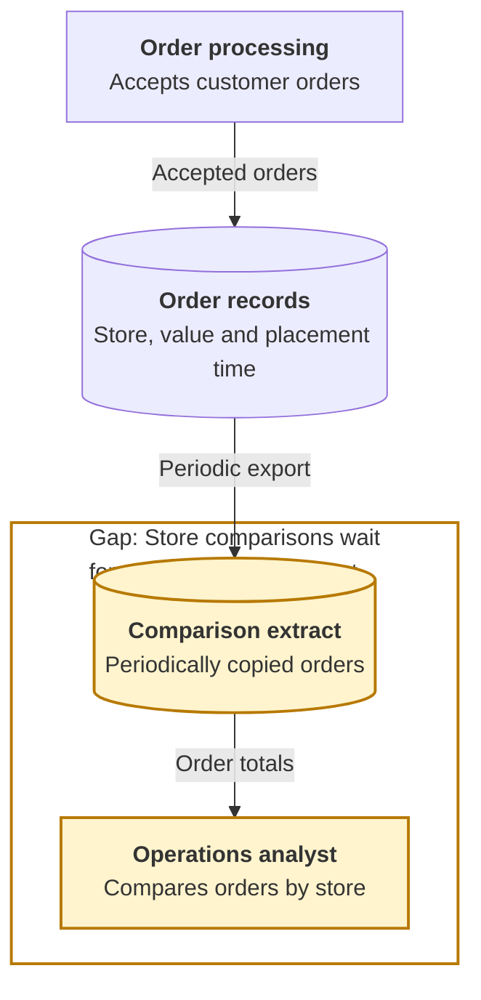
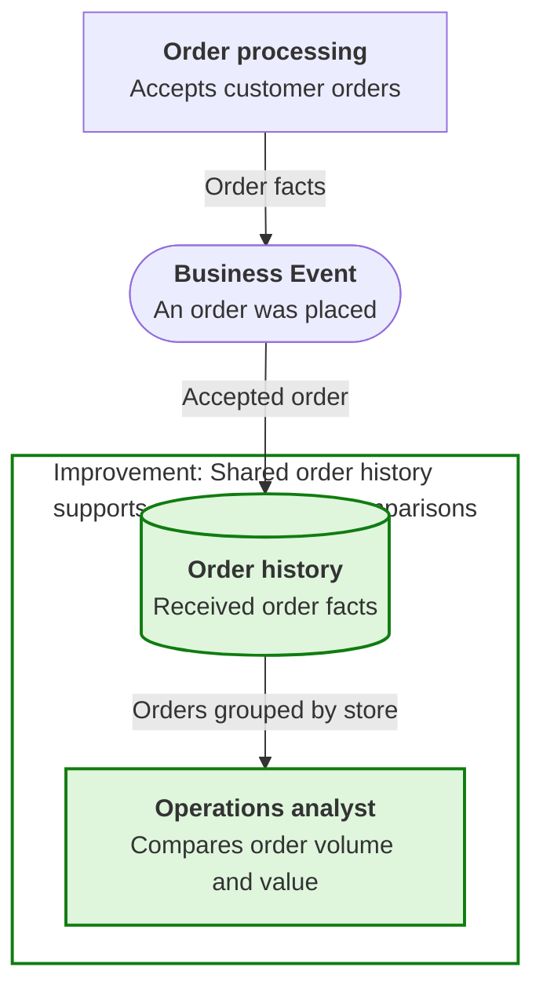
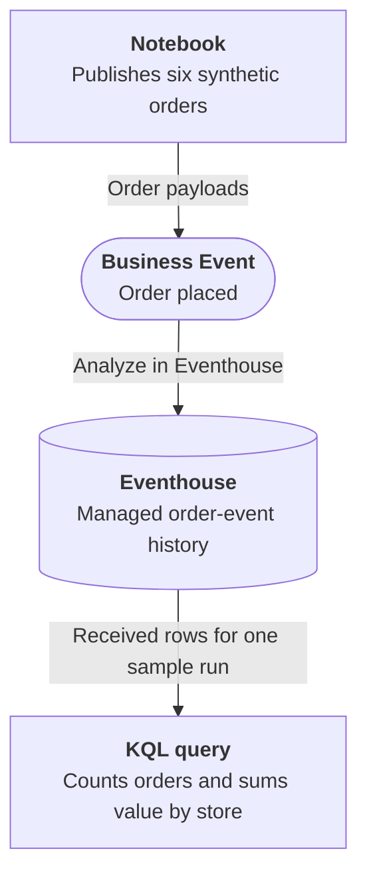

# Order History Analysis

## Business Context

A retail operations analyst compares accepted orders across stores to understand order volume and value. The order system records each order, while the analyst works from periodic exports. This example starts with two stores and a small set of synthetic orders; it does not assume an integration with a real retailer.

## Current Problem

The comparison depends on preparing another extract before analysis can begin. The order facts already exist, but they are not yet available as a shared history of business activity. Repeating the export also makes it easy to mix different runs of a learning exercise or count the same order more than once.

## Business Events

An accepted order becomes a shared finding with a consistent meaning. An independent history consumer records those findings so the analyst can compare stores without requesting a new export from the publisher. A run identifier separates exercises, and an order identifier supports counting each order once within a run.

## Event-driven architecture {#architecture}

**Business signal:** `Retail.Orders.OrderPlaced` 
**Publisher:** Notebook 
**Consumer:** Eventhouse, through **Analyze in Eventhouse** 
**Level:** Beginner - guided native setup and one result query

1. The Notebook publishes six synthetic orders using the documented Business Events API.
2. **Analyze in Eventhouse**, selected during event creation, creates a dedicated KQL table and persists received events. This is the required history consumer, not an optional extension or a database populated directly by the Notebook.
3. The analyst filters one sample run, deduplicates its order identifiers and compares the two stores.

The [Workbook](order-history-analysis/deployment.md) contains the schema, source cell, query and exact expected results. Setup uses the native Fabric interface; there is no deployment package or automatic provisioning claim.

## Business outcome and boundaries

The exercise ends with **six distinct orders**, **three per store**, and **USD 900 in total order value** visible in the history query. North contributes USD 350 and South USD 550.

**Where the exercise stops:** these are placed-order values, not recognized revenue, collected payments or fulfilled orders. A history row proves receipt by the history consumer, not completion of another business action. The query's sample-specific deduplication is not an exactly-once delivery guarantee or a general reconciliation strategy.

No Activator rule, Teams message, Power Automate flow, production order system or external customer data is needed.

## Try the Workbook

Open the [Workbook](order-history-analysis/deployment.md){#deploy-this-scenario} to create the event with managed history, publish one sample and inspect the store comparison.
