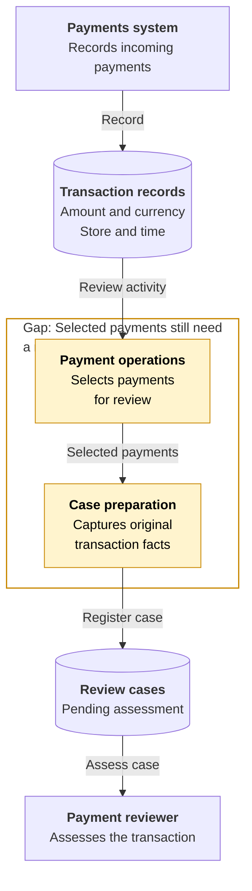
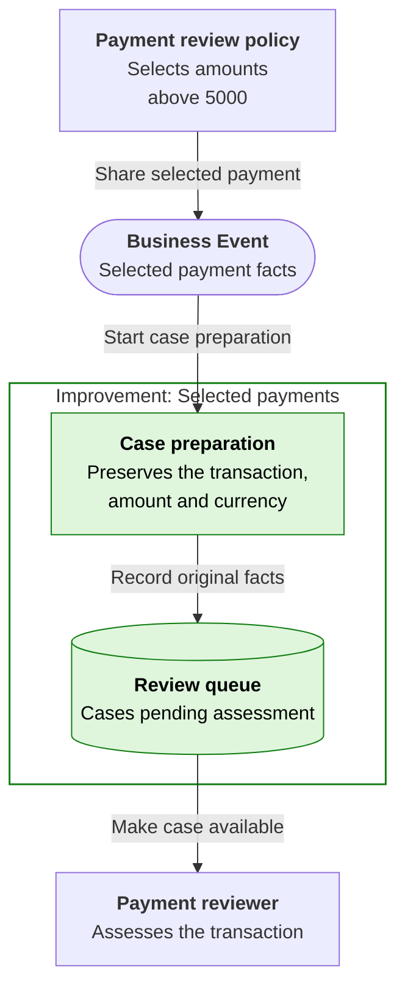
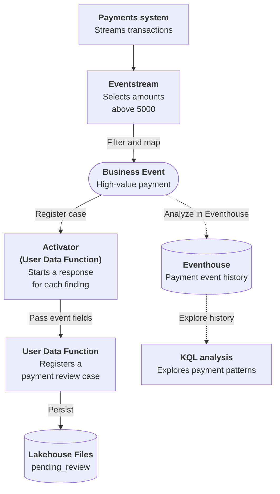

# Real-Time Stream Alert

## Business Context

Retail payments arrive continuously, and the payments system retains the transaction identity, amount, currency, store and processing time. Payment operations applies a review policy to identify transactions that deserve closer assessment. The reviewer works from a case, not from the full transaction feed.

The current process in this scenario requires the selected payment to be copied into a review register before that assessment can begin. The person preparing the case must keep the original amount and currency together; a large number in one currency is not a comparable risk score across all currencies. Identifying a qualifying payment and making it available to a reviewer are therefore two distinct responsibilities, and the second can remain unfinished even when the first has succeeded.

## Current Problem

The payment activity can contain a qualifying transaction without a case appearing in the review queue. Asking reviewers to search the wider activity and copy payment details leaves a gap between identifying a review condition and organizing the work.

A separate process that interprets the amount condition again can also select a different population. Review needs a consistent finding with its original currency, not an assumption that a large payment is fraudulent.

## Improved Business Response {#business-events}

A qualifying payment starts case preparation with the same transaction, amount and currency that caused it to qualify. The payment flow selects transactions above the sample review threshold and publishes each qualifying finding as a Business Event.

Reviewers get work they can pick up instead of having to assemble a queue from payment activity. Payment operations retains its selection policy, and the review team can change case preparation without taking over detection. The response registers a review need; it does not block the payment.

## Event-driven architecture {#architecture}

**Business signal:** `Retail.Payment.HighValueTransaction`

**Publisher:** Eventstream | **Consumer(s):** Activator (User Data Function)

1. Eventstream receives the payment activity and selects amounts strictly above 5000 in each payment's local currency units.
2. The matching transaction is mapped to a Business Event. Activator starts the review response for each received finding.
3. The response User Data Function saves a payment review case in Lakehouse Files, preserving the original transaction, amount and currency.

Eventstream owns the filter. Review cases are JSON records in Lakehouse Files.

Dashed arrows show optional event history and its analysis, separate from the required response. **Analyze in Eventhouse** is a creation-time choice, not a connection enabled by the deployment package or a prerequisite for completing the Workbook.

## Business outcome and boundaries

Create three saved payment review cases with status `pending_review` from six payments. Preserve the transaction, amount and currency so reviewers know which finding needs attention.

**Where the exercise stops:** Exactly 5000 and lower amounts create no Business Event or review case. The threshold uses each payment's local currency units, with no conversion; it is a sample policy, not a fraud verdict, payment block or cross-currency risk comparison.

## Try the Workbook

The [Workbook](real-time-stream-alert/deployment.md){#deploy-this-scenario} brings preparation, connections, sample inputs, expected results and code reference into one place. Follow that single path to explore the outcome above.

