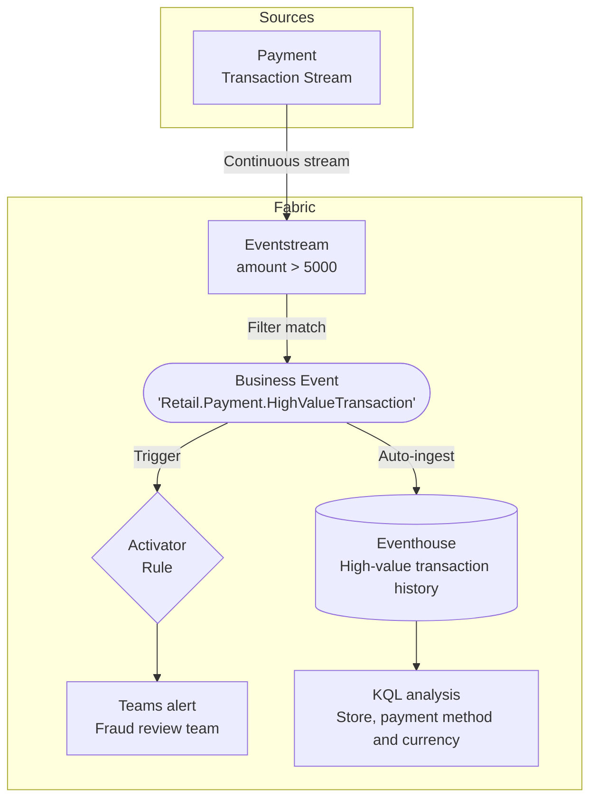
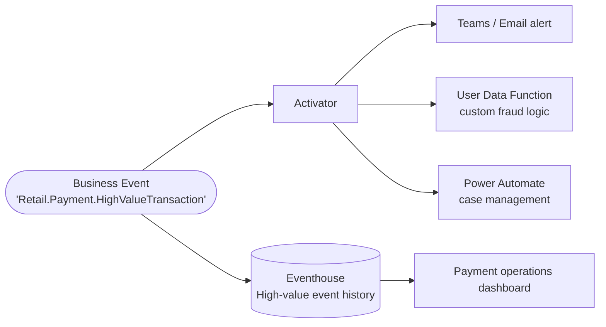

# Real-Time Stream Alert

**Publisher:** Eventstream | **Consumers:** Activator, Eventhouse

## Business context

A retail company processes a continuous stream of payment transactions from multiple stores and channels. Most transactions are routine, but high-value transactions above a defined threshold require immediate review by the fraud team.

Eventstream already evaluates the transaction stream and can identify records above the threshold. This scenario publishes that finding as a `Retail.Payment.HighValueTransaction` Business Event. The fraud team needs an immediate notification, while payment operations needs a history of selected transactions to compare high-value activity by store, payment method, and currency. A high value indicates a review condition, not proof of fraud.

**The problem without Business Events:**
A direct Activator rule on the stream may be sufficient for one alert. When more teams need the high-value signal, separate filters and integrations can duplicate its definition and make threshold changes harder to coordinate.

**The solution with Business Events:**
Eventstream keeps the filter and publishes the matching transaction through a named contract. Activator uses that event for the review notification, and Eventhouse independently stores the same event for historical analysis. Adding analytics does not require another high-value filter, a separate Eventstream-to-Eventhouse destination, or alert-channel logic in the publisher.

## Deploy this scenario

**Status: Reference implementation available.** The matching package is [`cicd/high-value-payment`](https://github.com/microsoft/fabric-events/tree/main/cicd/high-value-payment). It uses the same `Retail.Payment.HighValueTransaction` contract as this Real-Time Stream Alert scenario.

[Open the deployment and testing guide](real-time-stream-alert/deployment.md).

The native Eventstream filters `amount > 5000`, maps the six event fields and publishes to independent Activator and Eventhouse consumers. The separate test injects all external payment fixtures into the Eventstream; Python does not select high-value transactions or publish the Business Events itself. The test custom endpoint and individual Teams recipient are explicit sample choices, not a production payment-source connection or a configured fraud-team channel.

!!! note "Customer setup"
    The scripts are an implementation reference, not a generally available customer provisioning flow. Follow the complete manual walkthrough below for customer setup. Resource preparation and explicit testing remain separate responsibilities.

The complete manual walkthrough remains below. The package is an alternative way to prepare and test the sample, not a requirement for following this scenario.

## Architecture



| Component | Role |
|---|---|
| Publisher | Eventstream filters payment records where `amount > 5000` |
| Consumer 1 | Activator sends a Teams notification for each received high-value event |
| Consumer 2 | Eventhouse stores the selected payment events for historical analysis |
| Schema set | `RetailPayments` |
| Event type and KQL table | `Retail.Payment.HighValueTransaction` |

## Step 1: Create the Business Event

Before configuring the Eventstream, define the Business Event in Real-Time Hub.

1. Go to [Real-Time Hub → Business Events → Create](https://learn.microsoft.com/en-us/fabric/real-time-hub/business-events/create-business-events).
2. Create or select an Event Schema Set. Use `RetailPayments` as the schema set name.
3. Name the event `Retail.Payment.HighValueTransaction`.
4. In the schema editor, paste the following JSON:

    ```json
    {
      "type": "record",
      "name": "Retail.Payment.HighValueTransaction",
      "fields": [
        {
          "name": "transaction_id",
          "type": "string",
          "doc": "Unique identifier of the payment transaction"
        },
        {
          "name": "payment_method",
          "type": "string",
          "doc": "Payment method used: credit_card, debit_card, or digital_wallet"
        },
        {
          "name": "amount",
          "type": "float",
          "doc": "Transaction amount in the store's local currency"
        },
        {
          "name": "currency",
          "type": "string",
          "doc": "ISO 4217 currency code, for example USD or MXN"
        },
        {
          "name": "store_id",
          "type": "string",
          "doc": "Identifier of the store where the transaction was processed"
        },
        {
          "name": "processed_at",
          "type": "string",
          "doc": "Timestamp when the transaction was processed, ISO 8601 format"
        }
      ]
    }
    ```

5. Keep **Analyze in Eventhouse** enabled. Create a new Eventhouse or select an existing one in your workspace. Fabric automatically creates the dedicated `Retail.Payment.HighValueTransaction` KQL table.
6. Select **Create**.

## Step 2: Publisher - Eventstream

Eventstream is configured entirely from the UI. There is no code to write. You apply a filter transformation to the transaction stream and route matching events to the Business Event destination.

### Create the Eventstream

1. In your Fabric workspace, select **+ New item** and create an **Eventstream** named `PaymentTransactionStream`.
2. In the Eventstream editor, add your payment transaction data source. Connect it to the stream that produces transaction records with at least the fields defined in the schema above.

### Add a filter transformation

3. On the **Transform events or add destination** card, select the down arrow and choose **Filter**.
4. Select the **Action** link on the Filter card.
5. In the **Filter** window, configure the following:
    - **Operation name**: `HighValueFilter`
    - **Field**: `amount`
    - **Condition**: `Greater than`
    - **Value**: `5000`
6. Select **Save**.

### Add the Business Events destination

7. On the **HighValueFilter** card, select **Action** or the **+** button.
8. In the list of destinations, select **Business events**.
9. On the Business events card, select the **Edit** (pencil icon).
10. In the **Business events** window:
    - For **Destination name**, enter `HighValueTransactionPublisher`.
    - For **Business event type**, select **Choose** and select `Retail.Payment.HighValueTransaction`.
11. Select **Save**.

### Map the schema fields

12. On the `Retail.Payment.HighValueTransaction` card, select **Add** next to **Add a mapper to map schema**.
13. In the **Map schema** window, verify that each stream field maps to the corresponding schema field, and select **Finish**.
14. Select **Publish** to activate the Eventstream.

For full details on configuring Eventstream as a Business Events publisher, see the [Eventstream publisher documentation](https://learn.microsoft.com/en-us/fabric/real-time-hub/business-events/business-events-event-stream-publisher) and the [end-to-end tutorial](https://learn.microsoft.com/en-us/fabric/real-time-hub/business-events/tutorial-business-events-event-stream-user-data-function-activator).

## Step 3: Consumers - Activator and Eventhouse

### Consumer 1: Notify reviewers with Activator

When a `Retail.Payment.HighValueTransaction` event is published, Activator evaluates the rule and triggers a Teams alert to the fraud review team.

#### Set up the alert rule

1. In Microsoft Fabric, navigate to **Real-Time** on the left navigation bar.
2. Select **Business events** in Real-Time Hub.
3. Locate the `Retail.Payment.HighValueTransaction` event under your schema set.
4. Select **Set alert** from the event options.

#### Configure the rule

**Details section**

Enter a name for the rule, for example: `High Value Transaction Alert`.

**Monitor section**

1. In the **Source** field, select **Business events**.
2. In the **Connect data source** wizard, select the `Retail.Payment.HighValueTransaction` event type.
3. Select **Next**, review the settings, and select **Save**.

**Condition section**

Set **Check** to `On each event`.

**Action section**

1. For **Select action**, choose `Teams` then `Channel post`.
2. Configure the Teams channel for the fraud review team.
3. In **Context**, add `transaction_id`, `amount`, `store_id`, and `payment_method` so the alert includes the relevant details.
4. Save and activate the rule.

### Consumer 2: Analyze high-value activity in Eventhouse

Open the Eventhouse KQL database selected in Step 1. Its dedicated table receives the Business Events independently of Activator and Teams. It contains the high-value findings published by Eventstream, not the full raw payment stream or the outcome of a fraud review.

**Inspect the latest high-value events:**

```kusto
['Retail.Payment.HighValueTransaction']
| order by ingestion_time() desc
| take 50
```

**Compare received high-value activity by store and payment method:**

```kusto
['Retail.Payment.HighValueTransaction']
| where ingestion_time() > ago(7d)
| summarize ReceivedEvents = count(), LargestAmount = max(amount)
    by store_id, payment_method, currency
| order by ReceivedEvents desc
```

**Track hourly high-value event volume by currency:**

```kusto
['Retail.Payment.HighValueTransaction']
| where ingestion_time() > ago(24h)
| summarize ReceivedEvents = count()
    by currency, ReceivedHour = bin(ingestion_time(), 1h)
| order by ReceivedHour asc
```

Amounts are in the transaction's local currency. Keep currency in monetary comparisons rather than adding unlike currencies. The sample threshold is `5000` local-currency units; currency-specific thresholds are a separate policy decision. Counts represent received event records and can include repeated publications or deliveries. Calculating the high-value share of all payments requires the underlying payment stream as well.

Save these queries to a Real-Time Dashboard for payment operations. See [Eventhouse and Business Events integration](https://learn.microsoft.com/en-us/fabric/real-time-hub/business-events/business-events-eventhouse) for the dashboard steps.

## Step 4: End-to-end test

With the Eventstream published, the Activator rule saved, and Eventhouse integration enabled, send these two records through the configured payment source. Use new transaction IDs for each test run.

| Field | Above-threshold record | Boundary record |
|---|---|---|
| `transaction_id` | `demo-review-6001` | `demo-boundary-5000` |
| `payment_method` | `credit_card` | `credit_card` |
| `amount` | `6000` | `5000` |
| `currency` | `MXN` | `MXN` |
| `store_id` | `store-mx-042` | `store-mx-042` |
| `processed_at` | Current UTC time in ISO 8601 format | Current UTC time in ISO 8601 format |

1. In Real-Time Hub, select `Retail.Payment.HighValueTransaction` and confirm that `PaymentTransactionStream` appears on the **Publisher** tab.
2. On the **Data preview** tab, select that publisher and confirm that the `6000` record appears. The `5000` record should not be published because the filter is strictly greater than `5000`.
3. Confirm that the Teams notification contains the above-threshold transaction's ID and amount. The boundary record should not trigger this rule.
4. In the Eventhouse KQL database, run:

    ```kusto
    ['Retail.Payment.HighValueTransaction']
    | where ingestion_time() > ago(1h)
    | where transaction_id in ("demo-review-6001", "demo-boundary-5000")
    | project ReceivedAt = ingestion_time(), transaction_id, amount,
        currency, store_id, payment_method
    | order by ReceivedAt desc
    ```

5. Confirm that the above-threshold transaction is stored and that the boundary transaction is absent from this Business Event table.

The test is complete only when the matching payment reaches both the Teams notification and Eventhouse, and the boundary payment reaches neither. The raw source may still retain both payments. An Eventhouse row verifies analytical delivery, not completion of a fraud review or a payment block.

## What happens next

The same high-value finding now supports immediate review and historical payment analysis. Further consumers can be added without changing the Eventstream filter. Review decisions, case status, and confirmed fraud outcomes must be captured separately if analytics needs those outcomes.



| Extension | What it enables |
|---|---|
| **Teams / Email alert** | Immediate notification to the fraud review team |
| **User Data Function** | Run custom fraud scoring or call an external risk API |
| **Power Automate** | Open a case in your case management system automatically |
| **Real-Time Dashboard** | Visualize the existing Eventhouse history by store, payment method, and currency |
| **Review-outcome correlation** | Join with separately captured case outcomes for review-effectiveness analysis |
