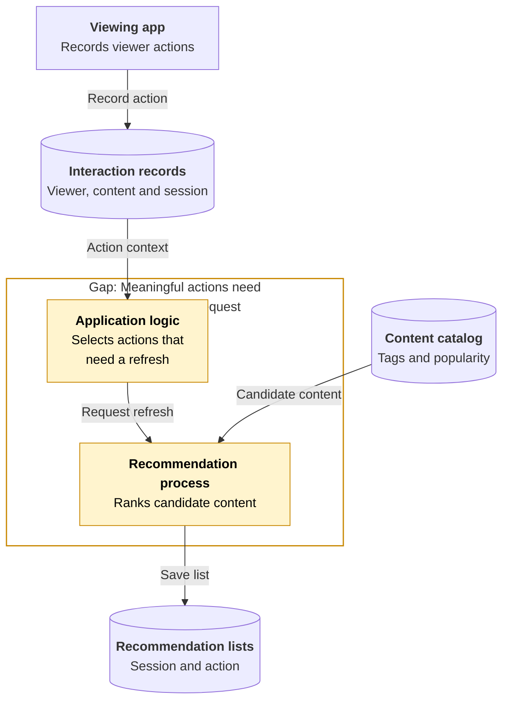
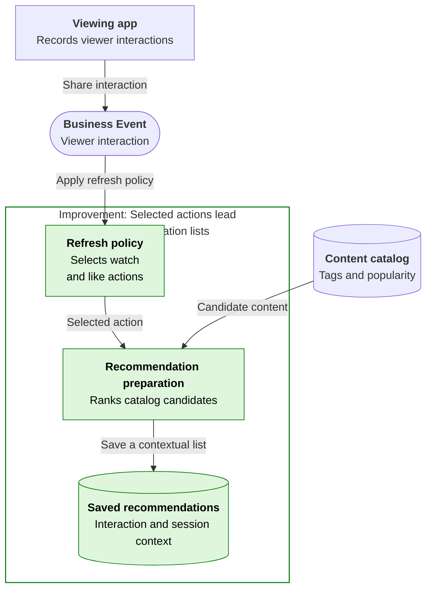
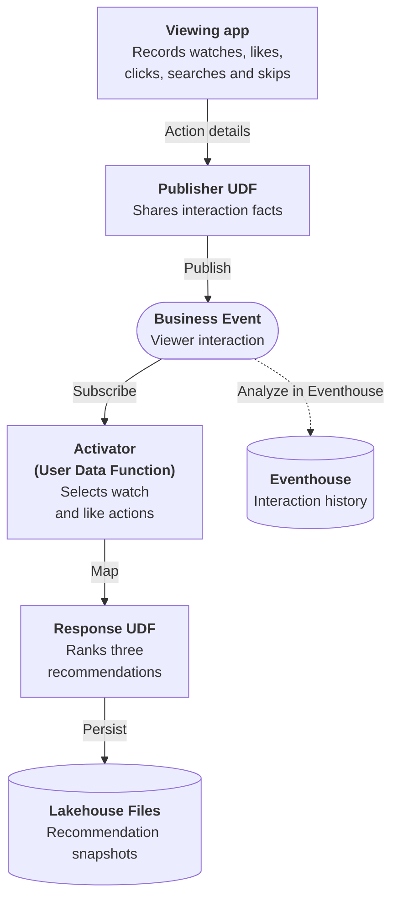

# Real-Time Viewer Recommendations

## Business Context

A viewing application records watches, likes, clicks, searches and skips with the viewer, content and session context. A separate recommendation process uses a content catalog to prepare suggestions. The product team must decide which interactions express enough interest to justify refreshing those suggestions, rather than treating every action as equally meaningful.

In this operating model, application-specific logic connects recorded interactions to requests for a new list. It must choose the relevant action and carry the right viewer and session context into recommendation preparation. Collecting more interaction history does not, on its own, make a refreshed list available. The business needs a consistent response to meaningful viewing behavior without turning every application interaction into another place to maintain recommendation rules.

## Current Problem

An interaction record does not, by itself, prepare a recommendation list. Treating every click or search as a reason to refresh also fails to distinguish stronger expressions of interest, such as watching or liking a title.

The team needs selected actions to initiate recommendation work with enough context to explain which interaction produced each list, without making the viewing application own the ranking process.

## Improved Business Response {#business-events}

The recommendation response selects watch and like actions, prepares suggestions from the sample catalog and saves the resulting list with its triggering interaction and session. The application shares each interaction as a Business Event.

Meaningful actions now lead to a usable next set of suggestions rather than remaining records alone. The product team can change which actions deserve a refresh without embedding recommendation processing in every interaction. Showing those lists and evaluating their effect on discovery or engagement remain separate product responsibilities.

## Event-driven architecture {#architecture}

**Business signal:** `Streaming.Viewer.BehaviorDetected`

**Publisher:** User Data Function | **Consumer(s):** Activator (User Data Function)

1. The publishing User Data Function shares the original interaction details as a Business Event, including actions that will not require a recommendation refresh.
2. Activator selects watch and like actions. Click, search and skip do not start the response.
3. The response User Data Function ranks the sample catalog by tag overlap and popularity, then saves a recommendation snapshot in Lakehouse Files with the interaction and session context.

The Workbook checks the saved lists and preserves the session context, including earlier or out-of-order interactions.

Dashed arrows show optional event history and its analysis, separate from the required response. **Analyze in Eventhouse** is a creation-time choice, not a connection enabled by the deployment package or a prerequisite for completing the Workbook.

## Business outcome and boundaries

Turn six viewer interactions into three persisted recommendation snapshots with status `ready_for_serving`. A small synthetic catalog ranks suggestions by tag overlap and then popularity.

**Where the exercise stops:** Click, search and skip create no response execution or recommendation file. This is a transparent sample without a trained model or profile inference. A saved snapshot does not prove that an application displayed it.

## Try the Workbook

The [Workbook](real-time-viewer-recommendations/deployment.md){#deploy-this-scenario} brings preparation, connections, sample inputs, expected results and code reference into one place. Follow that single path to explore the outcome above.

