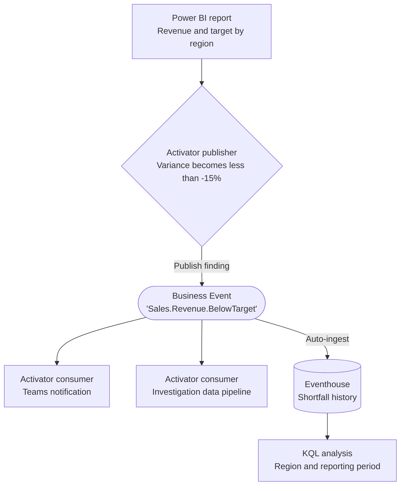

# Revenue Below Target

**Publisher:** Activator | **Consumers:** Activator, Eventhouse

## Business context

A sales team tracks revenue against regional targets in a Power BI report. When revenue falls more than 15% below the target for the same reporting period, the business owner needs a notification and refreshed investigation data. Sales operations also needs a history of the detected shortfalls to compare patterns across regions and periods.

**The problem without Business Events:**
A direct alert can notify the first owner. If each downstream workflow also calculates the variance, the threshold definition and reporting context can drift between teams. Adding historical analysis should not require another detector.

**The solution with Business Events:**
An Activator publisher monitors the report's revenue-variance measure and publishes `Sales.Revenue.BelowTarget` when the variance crosses below -15%. Independent Activator consumer rules notify the owner and run an investigation-data pipeline. Eventhouse stores the same signal for historical analysis. A stored shortfall is not proof that the owner responded or that revenue recovered.

## Deploy this scenario

**Status: Reference implementation available; fresh native end-to-end execution verified with an explicit individual Teams destination.** [`cicd/revenue-below-target`](https://github.com/microsoft/fabric-events/tree/main/cicd/revenue-below-target) contains the nine native resources, separate deployment and test launchers, the six-field event contract and ordered external source inputs.

[Read the complete deployment and verification guide](revenue-below-target/deployment.md).

!!! note "Verified reference, not general customer provisioning"
    A fresh deployment in the authorized reference environment passed all six native source states and both invalid-target guards: exactly two Business Events, two matching actual Teams cards, two completed native pipeline jobs and three useful persisted investigation rows. Automatic history association still requires the documented service capabilities. The executable reference uses an explicitly approved individual Teams destination; the manual channel setup below is a separate configuration.

The guide retains the strict **Becomes less than -15** crossing condition and separate native source, notification, pipeline-completion and Eventhouse evidence requirements. Deployment prepares an empty source; only the separate test changes its inputs. The complete manual walkthrough remains below.

## Architecture



| Component | Role |
|---|---|
| Source | Power BI report backed by a semantic model with revenue and targets for the same period and currency |
| Publisher | Activator detects a variance crossing below -15% |
| Consumer 1 | Independent Activator rules notify the owner and run an investigation-data pipeline |
| Consumer 2 | Eventhouse stores received shortfall signals for analysis |
| Schema set | `SalesPerformance` |
| Event type and KQL table | `Sales.Revenue.BelowTarget` |

Before starting, prepare a test report and a Data Factory pipeline that refreshes investigation data. The pipeline is a consumer action, not the source of the report's threshold calculation.

## Step 1: Create the Business Event

1. Go to [Real-Time Hub, Business Events, Create](https://learn.microsoft.com/en-us/fabric/real-time-hub/business-events/create-business-events).
2. Create or select an Event Schema Set named `SalesPerformance`.
3. Name the event `Sales.Revenue.BelowTarget`.
4. In the schema editor, paste:

    ```json
    {
      "type": "record",
      "name": "Sales.Revenue.BelowTarget",
      "fields": [
        {
          "name": "region",
          "type": "string",
          "doc": "Sales region whose revenue is below target"
        },
        {
          "name": "period_start",
          "type": "string",
          "doc": "Start of the reporting period in ISO 8601 format"
        },
        {
          "name": "revenue",
          "type": "double",
          "doc": "Revenue for the reporting period in the report's currency"
        },
        {
          "name": "target",
          "type": "double",
          "doc": "Positive revenue target for the same reporting period and currency"
        },
        {
          "name": "variance_pct",
          "type": "double",
          "doc": "100 * (revenue - target) / target; negative values mean below target"
        },
        {
          "name": "detected_at",
          "type": "string",
          "doc": "UTC model-refresh snapshot for the monitored row, ISO 8601 basic format yyyyMMddTHHmmssZ; not Activator ingestion time"
        }
      ]
    }
    ```

5. Keep **Analyze in Eventhouse** enabled. Create a new Eventhouse or select an existing one in your workspace. Fabric automatically creates the dedicated `Sales.Revenue.BelowTarget` KQL table.
6. Select **Create**.

## Step 2: Publisher - Activator on a Power BI report

### Prepare the report

Use a test semantic model with a `RevenuePerformance` table containing `region`, `period_start`, `revenue`, and `target`. Keep one reporting period and currency in the test report's filter context. Start with one region, for example `West`, revenue `90000`, and target `100000`.

Create a numeric measure for percentage variance:

```dax
variance_pct =
VAR RevenueAmount = SUM(RevenuePerformance[revenue])
VAR TargetAmount = SUM(RevenuePerformance[target])
RETURN
    IF(
        TargetAmount > 0,
        100 * DIVIDE(RevenueAmount - TargetAmount, TargetAmount)
    )
```

This measure returns `-10` for the starting values, not `-0.10`. Do not apply percentage formatting that multiplies it by 100 again. Zero or negative targets do not produce a valid variance in this example.

Add a calculated string column for the actual model-refresh snapshot UTC:

```dax
detected_at =
VAR SnapshotUtc = UTCNOW()
RETURN
    FORMAT(SnapshotUtc, "yyyyMMdd")
    & "T"
    & FORMAT(SnapshotUtc, "HHmmss")
    & "Z"
```

This ISO 8601 basic UTC representation preserves the timestamp as text through the verified native connector. The extended ISO representation was automatically converted to a culture-formatted datetime during source evaluation. `UTCNOW()` in this calculated column changes on model refresh: this is snapshot time, not Activator ingestion or alert activation time.

Create a supported **table visual** containing `region`, `period_start`, `revenue`, `target`, `detected_at` and `variance_pct`. Keep the native composite object identity limited to `region` and `period_start`; money and refresh timestamps are context, not object identity. The report's data refresh and the Activator evaluation cadence determine when a change is detected; publishing does not make the semantic model update continuously.

### Configure the publisher

1. On the report visual, select **Set alert**, then **Open in Activator**.
2. Monitor `variance_pct` and set the condition to **Becomes less than**, with value `-15`.
3. In **Action**, select **Publish a business event**.
4. Select `Sales.Revenue.BelowTarget`.
5. Map the fields:

    | Schema field | Source |
    |---|---|
    | `region` | Region from the monitored visual |
    | `period_start` | Reporting period from the visual, or a static ISO 8601 value for the single-period test |
    | `revenue` | Revenue for the monitored region and period |
    | `target` | Target for the same region and period |
    | `variance_pct` | The numeric variance measure |
    | `detected_at` | The same native source row's calculated UTC model-refresh snapshot |

6. Save and activate the publisher rule.

For production data, supply the current period dynamically rather than leaving a static test value. See [Activator as a Business Events publisher](https://learn.microsoft.com/en-us/fabric/real-time-hub/business-events/business-events-activator) for report entry points and field mapping.

## Step 3: Consumers - Activator and Eventhouse

### Consumer 1: Notify the business owner

1. In Real-Time Hub, locate `Sales.Revenue.BelowTarget` under `SalesPerformance`.
2. Select **Set alert** and name the rule `Revenue Shortfall - Owner Notification`.
3. In **Monitor**, select **Business events** and connect to this event.
4. Set **Condition** to `On each event`. The publisher already owns the shortfall threshold.
5. In **Action**, select **Teams**, then **Channel post**, and choose the test sales-operations channel.
6. Include `region`, `period_start`, `revenue`, `target`, `variance_pct`, and `detected_at` in the context.
7. Save the consumer rule.

For multiple regional owners, configure the destination or region-specific consumer rules according to your ownership model.

### Consumer 2: Refresh investigation data

Create a second Activator consumer rule on the same Business Event, again using `On each event`. Name it `Revenue Shortfall - Investigation Data`, select the **Data Pipeline** action, and choose the prepared investigation-data pipeline. Configure any parameters required by that pipeline and save the rule.

Keep this consumer separate from the publisher and notification rule. Do not have the investigation pipeline modify the source report's revenue or target values as part of this test.

### Consumer 3: Analyze shortfalls in Eventhouse

Open the Eventhouse KQL database selected in Step 1. No separate ingestion configuration is needed.

**Inspect recent shortfalls:**

```kusto
['Sales.Revenue.BelowTarget']
| order by ingestion_time() desc
| take 50
```

**Compare received findings by region and reporting period:**

```kusto
['Sales.Revenue.BelowTarget']
| where ingestion_time() > ago(30d)
| summarize ReceivedFindings = count(), WorstVariancePct = min(variance_pct)
    by region, period_start
| order by ReceivedFindings desc, WorstVariancePct asc
```

These are counts of received shortfall records, not unique incidents or lost revenue. Repeated publications or deliveries can increase counts. The table contains only published shortfalls, so measuring overall target attainment also requires the source revenue and target data.

Save the comparison query to a Real-Time Dashboard for sales operations. See [Eventhouse and Business Events integration](https://learn.microsoft.com/en-us/fabric/real-time-hub/business-events/business-events-eventhouse).

## Step 4: End-to-end test

Use the test region and reporting period from Step 2. Allow the report to refresh and the Activator publisher to evaluate after each change.

1. With revenue `90000` and target `100000`, confirm a variance of `-10`. Let the publisher observe this initial state.
2. Change revenue to `85000`, refresh the report, and let the publisher evaluate. A variance of exactly `-15` should not publish an event because the condition is strictly less than `-15`.
3. Change revenue to `80000`, refresh the report, and let the publisher evaluate. Confirm the `-20` shortfall in the Business Event's publisher data preview.
4. Verify the Teams notification contains the same region, period, and variance.
5. Verify the investigation-data pipeline run completes in its run history.
6. In the Eventhouse database, run:

    ```kusto
    ['Sales.Revenue.BelowTarget']
    | where ingestion_time() > ago(1h)
    | where region == "West"
    | project ReceivedAt = ingestion_time(), region, period_start,
        revenue, target, variance_pct
    | order by ReceivedAt desc
    ```

7. Confirm a row for revenue `80000`, target `100000`, and variance `-20`. The boundary value `-15` should not appear as a newly published shortfall from this test.

The test is complete only when the notification, pipeline run, and Eventhouse row are verified independently. Use a fresh region or isolate the test period when repeating the test so earlier findings are not mistaken for new ones.

## What happens next

Add regional response rules or analytics tiles using the same contract without changing the report's detector. Capture owner acknowledgement and investigation outcomes separately if you need to measure response effectiveness. The Business Event communicates a detected shortfall, not recovery or case completion.
