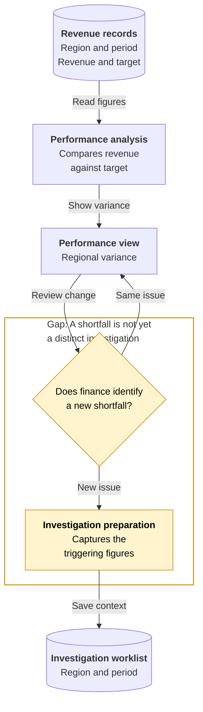
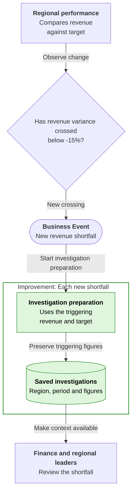
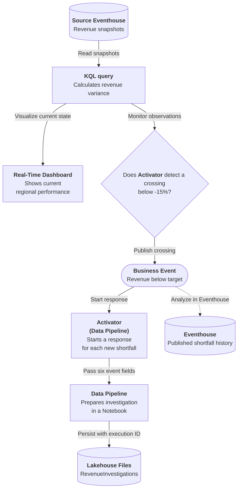

# Revenue Below Target

## Business Context

Finance and regional leaders monitor revenue against the target for each region and reporting period. A performance view shows the latest revenue, target and variance, while the underlying observations retain how that position has changed. The same region can stay below plan through several updates, recover and then fall behind again.

In this scenario, a finance analyst decides whether the latest observation warrants a new investigation, then assembles the figures for regional review. That decision requires more than the current percentage: the analyst must distinguish a continuing issue from a renewed decline and retain the values that prompted concern. Otherwise, each refresh can create more work for the same shortfall, or a later decline can be dismissed as something the team is already investigating.

## Current Problem

The current revenue position does not, by itself, distinguish a new reason to investigate from another observation of an existing shortfall. Opening work on every refresh creates noise; treating every later decline as the old issue can miss a renewed problem after recovery.

Finance also needs the figures that prompted the concern, not just whatever values happen to be displayed when someone begins the review.

## Improved Business Response {#business-events}

A new crossing into a qualifying shortfall starts preparation of an investigation from the triggering region, period, revenue and target figures. Those facts are shared as a Business Event. Continued observations below the threshold do not create more investigations.

Finance and regional leadership get a common starting point for discussing the gap, while a renewed decline after recovery can receive fresh attention. The event-driven handoff separates the business decision to investigate from the changing display of current performance.

## Event-driven architecture {#architecture}

**Business signal:** `Sales.Revenue.BelowTarget`

**Publisher:** Activator (Business Event publication) | **Consumer(s):** Activator (Data Pipeline)

1. The revenue query reads source observations from Eventhouse. The Dashboard shows current regional performance while the publishing Activator monitors the same business condition.
2. A crossing strictly below -15% publishes a Business Event. Continued shortfall observations do not publish another crossing; recovery allows a later crossing to qualify.
3. The consuming Activator starts the Data Pipeline with the triggering figures. The pipeline prepares and saves the investigation in Lakehouse Files without reading event history.

The source Eventhouse is required for revenue observations. The Dashboard shows current performance; optional event history is a different branch and never supplies the pipeline's inputs.

## Business outcome and boundaries

Prepare a traceable investigation dataset in Lakehouse Files for each new crossing, with status `ready_for_review`. The Workbook follows a shortfall, recovery and second crossing, producing two investigations.

**Where the exercise stops:** The exact -15% boundary, continued observations below the threshold and recovery do not start another investigation. Zero or negative targets do not qualify. A saved analysis is not a reviewed recovery plan or proof that revenue improved.

## Try the Workbook

The [Workbook](revenue-below-target/deployment.md){#deploy-this-scenario} brings preparation, connections, sample inputs, expected results and code reference into one place. Follow that single path to explore the outcome above.

