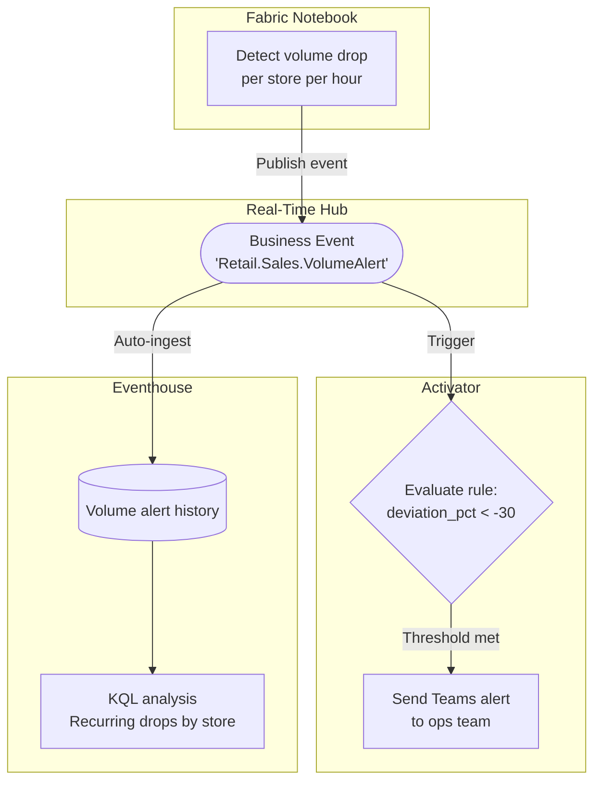
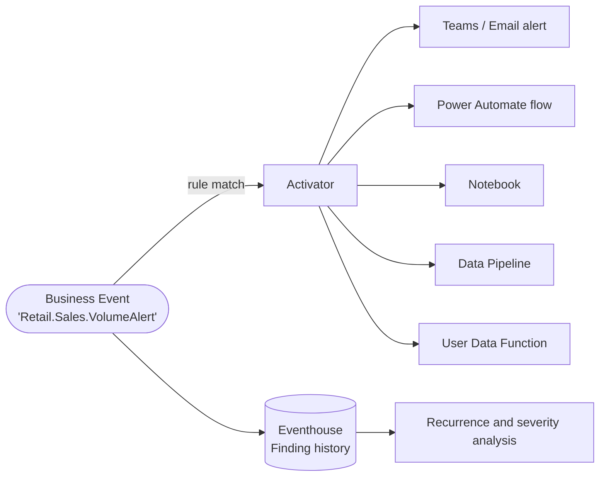

# Sales Volume Alert

**Publisher:** Notebook | **Consumers:** Activator, Eventhouse

## Business context

A retail company runs daily sales processing in Microsoft Fabric. Each store is expected to process a baseline number of transactions per hour based on historical data. If a store's transaction volume drops significantly below its expected baseline, it may indicate a failure in the point-of-sale integration, not a natural slowdown.

The notebook already compares actual volume with the baseline. Operations needs that finding in time to investigate a possible integration failure. Retail analytics needs a history of the same findings to identify stores with recurring volume drops and compare their severity over time.

**The problem without Business Events:**
If the notebook calls each notification or analytics service directly, adding a response means updating the detection workload. Separate implementations can also interpret the same volume drop differently.

**The solution with Business Events:**
The notebook keeps its detection logic and publishes a `Retail.Sales.VolumeAlert` event with the store and deviation context. Two independent consumers use that contract: Activator notifies operations for deviations below -30%, while Eventhouse retains every received finding for historical analysis, including findings that do not match the alert rule. The notebook does not call either consumer directly.

## Architecture



| Component | Role |
|---|---|
| Publisher | Notebook calculates the volume deviation and publishes the finding |
| Consumer 1 | Activator filters for deviations below -30% and sends a Teams alert |
| Consumer 2 | Eventhouse stores received findings for recurrence and severity analysis |
| Schema set | `RetailSales` |
| Event type and KQL table | `Retail.Sales.VolumeAlert` |

## Step 1: Create the Business Event

Before publishing any event, you need to define it in Real-Time Hub.

1. Go to [Real-Time Hub → Business Events → Create](https://learn.microsoft.com/en-us/fabric/real-time-hub/business-events/create-business-events).
2. Create or select an Event Schema Set. Use `RetailSales` as the schema set name. Note the name and workspace. They map directly to `SCHEMA_SET_NAME` and `WORKSPACE_NAME` in the publisher code.
3. Name the event `Retail.Sales.VolumeAlert`.
4. In the schema editor, paste the following JSON:

    ```json
    {
      "type": "record",
      "name": "Retail.Sales.VolumeAlert",
      "fields": [
        {
          "name": "store_id",
          "type": "string",
          "doc": "Unique identifier of the store reporting the alert"
        },
        {
          "name": "expected_transactions",
          "type": "int",
          "doc": "Expected number of transactions based on historical average"
        },
        {
          "name": "actual_transactions",
          "type": "int",
          "doc": "Actual transactions recorded in the current monitoring window"
        },
        {
          "name": "deviation_pct",
          "type": "float",
          "doc": "Percentage deviation from expected volume. Negative means below expected."
        },
        {
          "name": "window_start",
          "type": "string",
          "doc": "Start of the monitoring window in ISO 8601 format"
        },
        {
          "name": "severity",
          "type": "string",
          "doc": "Alert severity level: low, medium, high"
        }
      ]
    }
    ```

5. Keep **Analyze in Eventhouse** enabled. Create a new Eventhouse or select an existing one in your workspace. Fabric automatically creates the dedicated `Retail.Sales.VolumeAlert` KQL table.
6. Select **Create**. No separate ingestion pipeline or direct Notebook-to-Eventhouse write is needed.

## Step 2: Publisher - Notebook

The notebook queries the sales data, calculates the deviation per store, and publishes a Business Event for each store that exceeds the threshold.

### Create the Notebook

1. In your Fabric workspace, select **+ New item** and create a **Notebook**.
2. Attach it to a Lakehouse that contains your sales data, or use the hardcoded values provided below for testing.

### Notebook code

Replace `WORKSPACE_NAME` with your Fabric workspace name and `SCHEMA_SET_NAME` with the name of the Event Schema Set associated with the Business Event you created in [Real-Time Hub → Business Events](https://learn.microsoft.com/en-us/fabric/real-time-hub/business-events/create-business-events).

```python
# Publish a Retail.Sales.VolumeAlert Business Event from a Fabric Notebook
# notebookutils reference: https://learn.microsoft.com/en-us/fabric/data-engineering/microsoft-spark-utilities

WORKSPACE_NAME = "<your-workspace-name>"
SCHEMA_SET_NAME = "<your-schema-set-name>"
EVENT_NAME = 'Retail.Sales.VolumeAlert'

# Calculate deviation for a store
store_id = "store-mx-042"
expected = 1250
actual = 743
deviation_pct = round(((actual - expected) / expected) * 100, 2)
severity = 'high' if deviation_pct < -30 else 'medium' if deviation_pct < -15 else 'low'

# Build the event payload
payload = {
    'store_id': store_id,
    'expected_transactions': expected,
    'actual_transactions': actual,
    'deviation_pct': deviation_pct,
    'window_start': "2024-06-22T09:00:00Z",
    'severity': severity
}

# Publish to Business Events
notebookutils.businessEvents.publish(
    eventSchemaSetWorkspace=WORKSPACE_NAME,
    eventSchemaSet=SCHEMA_SET_NAME,
    eventTypeName=EVENT_NAME,
    eventData=payload,
    dataVersion='v1'
)
```

## Step 3: Consumers - Activator and Eventhouse

### Consumer 1: Notify operations with Activator

When the `Retail.Sales.VolumeAlert` Business Event is published to Real-Time Hub, Activator can subscribe to it and trigger an action when the rule condition is met.

#### Set up the alert rule

1. In Microsoft Fabric, navigate to **Real-Time** on the left navigation bar.
2. Select **Business events** in Real-Time Hub.
3. Locate the `Retail.Sales.VolumeAlert` event under your schema set.
4. Select **Set alert** from the event options.

#### Configure the rule

**Details section**

Enter a name for the rule, for example: `Sales Volume Drop Alert`.

**Monitor section**

1. In the **Source** field, select **Business events**.
2. In the **Connect data source** wizard, select the `Retail.Sales.VolumeAlert` event type.
3. Select **+ Filter** and configure the following filter:
    - Field: `deviation_pct`
    - Operator: `Less than`
    - Value: `-30`
4. Select **Next**, review the settings, and select **Save**.

**Condition section**

Set **Check** to `On each event`.

**Action section**

1. For **Select action**, choose `Teams` then `Channel post`.
2. Configure the Teams channel to notify the operations team.
3. In **Context**, add `store_id`, `actual_transactions`, and `deviation_pct` so the alert includes the relevant details.
4. Save and activate the rule.

### Consumer 2: Analyze recurring drops in Eventhouse

Eventhouse integration was enabled in Step 1. Open the selected Eventhouse KQL database and query the automatically created table. The table name preserves dots, so use bracket syntax. Ingestion does not depend on the Activator filter or on Teams delivery.

**Inspect the latest findings:**

```kusto
['Retail.Sales.VolumeAlert']
| order by ingestion_time() desc
| take 50
```

**Find stores with repeated high-severity findings received in the last 7 days:**

```kusto
['Retail.Sales.VolumeAlert']
| where ingestion_time() > ago(7d)
| where deviation_pct < -30
| summarize HighSeverityFindings = count(),
    WorstDeviationPct = min(deviation_pct) by store_id
| order by HighSeverityFindings desc, WorstDeviationPct asc
```

**Compare the severity mix of received findings over time:**

```kusto
['Retail.Sales.VolumeAlert']
| where ingestion_time() > ago(7d)
| summarize Findings = count() by severity, ReceivedHour = bin(ingestion_time(), 1h)
| order by ReceivedHour asc
```

These queries count received event records, not confirmed incidents or distinct monitoring windows. Repeated publications or deliveries can increase the counts. A volume drop still needs investigation; the history does not prove a point-of-sale failure.

Use the recurrence query as a tile in a Real-Time Dashboard for operations reviews. See [Eventhouse and Business Events integration](https://learn.microsoft.com/en-us/fabric/real-time-hub/business-events/business-events-eventhouse) for querying and dashboard setup.

## Step 4: End-to-end test

Verify both consumers with two publications from the same notebook:

1. Run the notebook as-is. The values for `store-mx-042` produce a `deviation_pct` of `-40.56` and `severity` of `high`.
2. Confirm that the Teams alert includes the store and deviation.
3. Change `actual` to `1000`, leaving `expected` at `1250`, and run the notebook again. This publishes a `-20.0` deviation with `medium` severity. This event should be retained in Eventhouse but should not match the Activator filter.
4. In the Eventhouse KQL database, run:

    ```kusto
    ['Retail.Sales.VolumeAlert']
    | where ingestion_time() > ago(1h)
    | where store_id == "store-mx-042"
    | project ReceivedAt = ingestion_time(), store_id,
        expected_transactions, actual_transactions, deviation_pct, severity
    | order by ReceivedAt desc
    ```

5. Confirm that records for both `actual_transactions` values, `743` and `1000`, appear. Only the `-40.56` finding should match the Teams alert rule.

The test is complete when the high-severity finding reaches Teams and both findings are queryable in Eventhouse. Data preview or a successful publish call alone does not verify both consumers. The queries filter on receipt time because the hardcoded `window_start` is a sample timestamp. Replace the sample values with real sales windows when connecting the notebook to production data.

## What happens next

The scenario now pairs an immediate response with a queryable history. Activator can add other actions, while analytics can build dashboards from the existing Eventhouse table. Neither extension requires adding consumer-specific logic to the notebook.



| Action | When to use |
|---|---|
| **Teams / Email alert** | Notify a team or individual immediately when the condition is met |
| **Power Automate flow** | Trigger a business process or approval workflow outside Fabric |
| **Notebook** | Run a remediation or deeper analysis in response to the event |
| **Data Pipeline** | Kick off a downstream data processing job |
| **User Data Function** | Call custom logic or an external API |

For full details on configuring each action type, see the [Activator documentation](https://learn.microsoft.com/fabric/real-time-intelligence/activator/activator-introduction).
