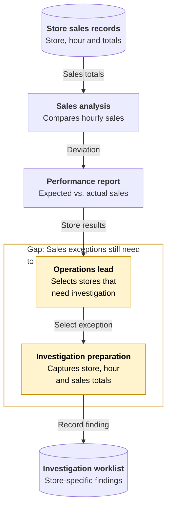
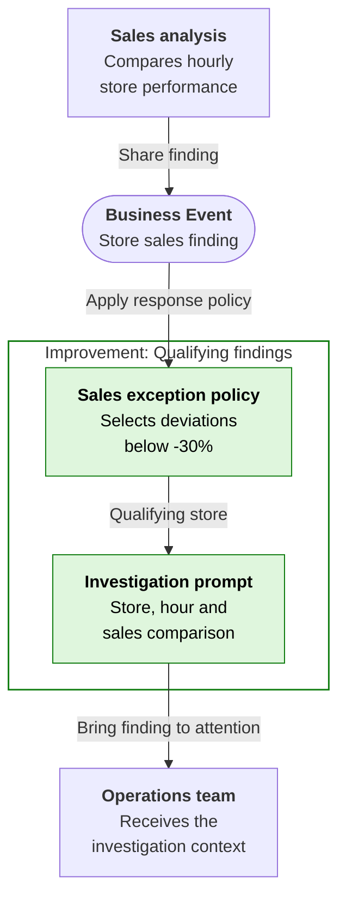
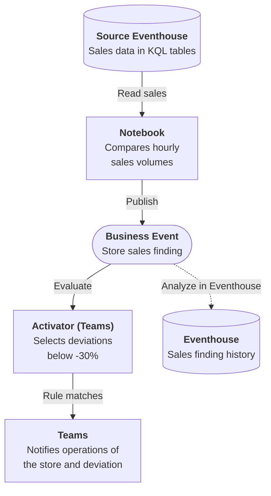

# Sales Volume Alert

## Business Context

Stores produce transaction totals throughout the trading day. Sales analysis compares each location's actual volume with its expected volume for the same hour, giving operations a view of which stores are performing normally and which deserve a closer look.

In the operating model described here, an operations lead reviews that comparison, selects a significant drop and prepares the store, trading hour and supporting figures for investigation. The report can be available while nobody has yet taken responsibility for investigating the exception. The business already knows how to measure the change; the delay is in turning that finding into work with enough context for someone to act.

## Current Problem

A significant drop can sit among routine observations until someone notices and passes it to operations. A notification without the store, expected volume and time window still leaves the recipient assembling the facts before an investigation can begin.

The team needs a consistent handoff from the sales comparison to operational attention, without treating every fluctuation as an incident or assuming what caused the drop.

## Business Events

The sales comparison publishes each store finding as a Business Event. Operations applies its agreed response threshold and receives an investigation prompt for the qualifying stores, with the original comparison and time window.

This changes the handoff from someone having to notice a report to a recognized condition starting the response. Operations can begin with the finding rather than request another extract. Another team can use the same finding without asking sales to build a different detector.

## Event-driven architecture {#architecture}

**Business signal:** `Retail.Sales.VolumeAlert`

**Publisher:** Notebook | **Consumer(s):** Activator (Teams)

1. The Notebook reads sales from the source Eventhouse and compares actual and expected hourly transactions for each store.
2. The store finding is published as a Business Event. Activator selects deviations strictly below -30%.
3. Teams delivers the selected store's context to operations, ready for investigation.

The source Eventhouse supplies sales inputs to the Notebook and is required. It is separate from the optional Eventhouse history branch.

Dashed arrows show optional event history and its analysis, separate from the required response. **Analyze in Eventhouse** is a creation-time choice, not a connection enabled by the deployment package or a prerequisite for completing the Workbook.

## Business outcome and boundaries

Give operations a store-specific Teams alert when transaction volume falls more than 30% below expectation. The Workbook compares six stores and produces two alerts ready for investigation.

**Where the exercise stops:** An alert does not explain the cause or show that sales recovered. The exact -30% boundary and less severe findings do not produce a Teams alert.

## Try the Workbook

The [Workbook](sales-volume-alert/deployment.md){#deploy-this-scenario} brings preparation, connections, sample inputs, expected results and code reference into one place. Follow that single path to explore the outcome above.

