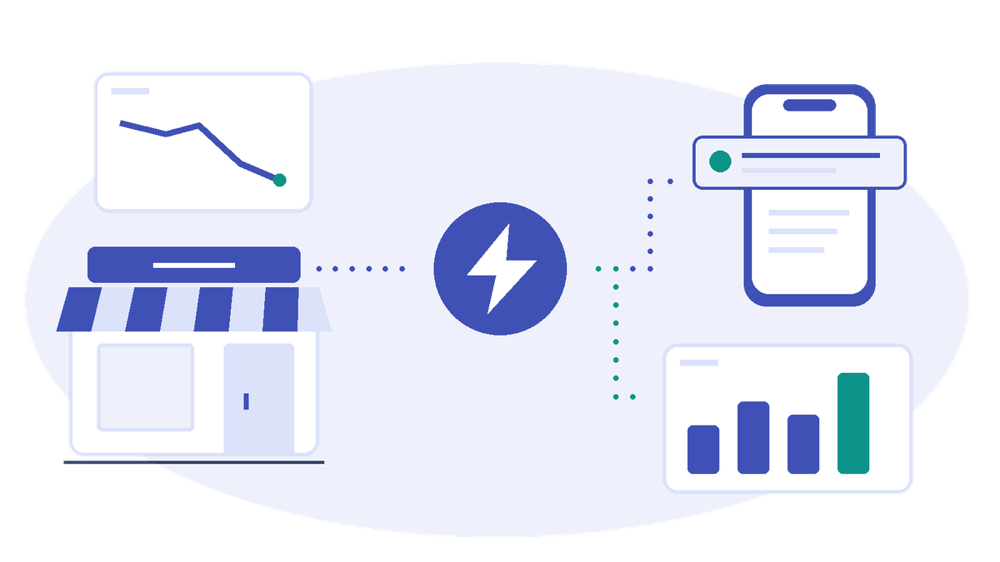

  <section class="h2-hero" aria-labelledby="home2-title">
    

      <h1 id="home2-title">One business signal. Many ways to act.</h1>
      
A sales dip. A newly placed order. Recognize what matters and share the facts teams need to act or analyze.

      
Your workloads already detect important business situations. <strong>Business Events</strong> represent those signals through a shared, schema-defined contract, so teams and applications can reuse the same business meaning and respond independently.

      

        <a class="md-button md-button--primary" href="../business-events/scenarios/order-history-analysis/">Build your first event</a>
        <a href="../business-events/introduction/what-are-business-events/">Understand the basics &rarr;</a>
      

    

    <figure>
      
      <figcaption>Keep your detection. Share the signal. Enable independent responses.</figcaption>
    </figure>
  </section>

  <section class="h2-section" aria-labelledby="home2-scenarios-title">
    <h2 id="home2-scenarios-title">Find a moment worth acting on.</h2>
    

      <article class="h2-scene">
        
        <h3>Alert the team.</h3>
        
A Notebook detects a sales dip and publishes a Business Event. Activator sends a Teams alert; other consumers can reuse the same signal without changing the Notebook.

        <a href="../business-events/scenarios/sales-volume-alert/">Build a sales volume alert &rarr;</a>
      </article>
      <article class="h2-scene">
        
        <h3>Bring a customer back.</h3>
        
Share one cart abandonment signal with independent consumers for recovery actions and conversion analytics, instead of integrating each response into the publisher.

        <a href="../business-events/scenarios/abandoned-cart-recovery/">Explore cart recovery &rarr;</a>
      </article>
      <article class="h2-scene">
        
        <h3>Understand the activity.</h3>
        
Publish six synthetic orders from a Notebook, retain their Business Events in Eventhouse and compare order volume and value across two stores with KQL.

        <a href="../business-events/scenarios/order-history-analysis/">Explore order history analysis &rarr;</a>
      </article>
    

    
<a href="../business-events/scenarios/">Browse all scenarios &rarr;</a>

  </section>

  <section class="h2-section" aria-labelledby="home2-pillars-title">
    <h2 id="home2-pillars-title">Three pillars. One event-driven toolkit.</h2>
    

      

        <h3>Business Events</h3>
        
Shared, schema-defined representations of business signals that teams and applications can reuse without replacing existing detection logic.

        
<a href="../business-events/introduction/what-are-business-events/">Guides available now &rarr;</a>

      

      

        <h3>Fabric Events</h3>
        
Platform signals, such as item creation and workspace changes.

        
<em>Site coverage coming soon.</em>

      

      

        <h3>Azure Events</h3>
        
Cloud signals that connect Azure systems and Fabric workloads.

        
<em>Site coverage coming soon.</em>

      

    

  </section>

  <section class="h2-section" aria-labelledby="home2-resources-title">
    <h2 id="home2-resources-title">Go from an idea to a working solution.</h2>
    
Choose your next step, whether you are exploring Business Events or building your own integration.

    

      <article class="h2-resource">
        <h3>Build your first solution.</h3>
        
Follow a complete scenario, from the event schema and publisher to consumer setup and an end-to-end test.

        <a href="../business-events/scenarios/sales-volume-alert/">Start with a sales alert &rarr;</a>
      </article>
      <article class="h2-resource">
        <h3>Implement a specific task.</h3>
        
Use focused recipes to publish events in batches or chain two Business Events into a connected workflow.

        <a href="../business-events/recipes/">Find a recipe &rarr;</a>
      </article>
      <article class="h2-resource">
        <h3>Design for what comes next.</h3>
        
Explore payload design, schema versioning, retry behavior, and patterns for multiple independent consumers.

        <a href="../business-events/design-guides/">Explore design guides &rarr;</a>
      </article>
    

    
Need the platform reference? Read the <a href="https://learn.microsoft.com/fabric/real-time-hub/business-events/business-events-overview">official documentation</a>.

  </section>

