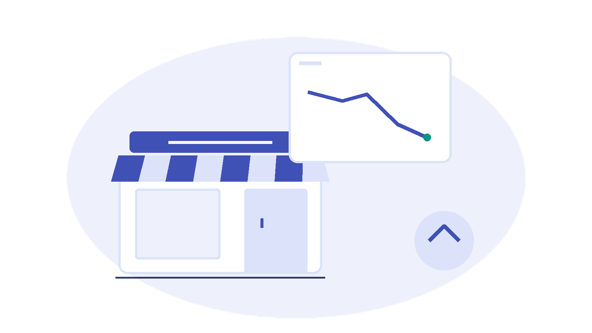
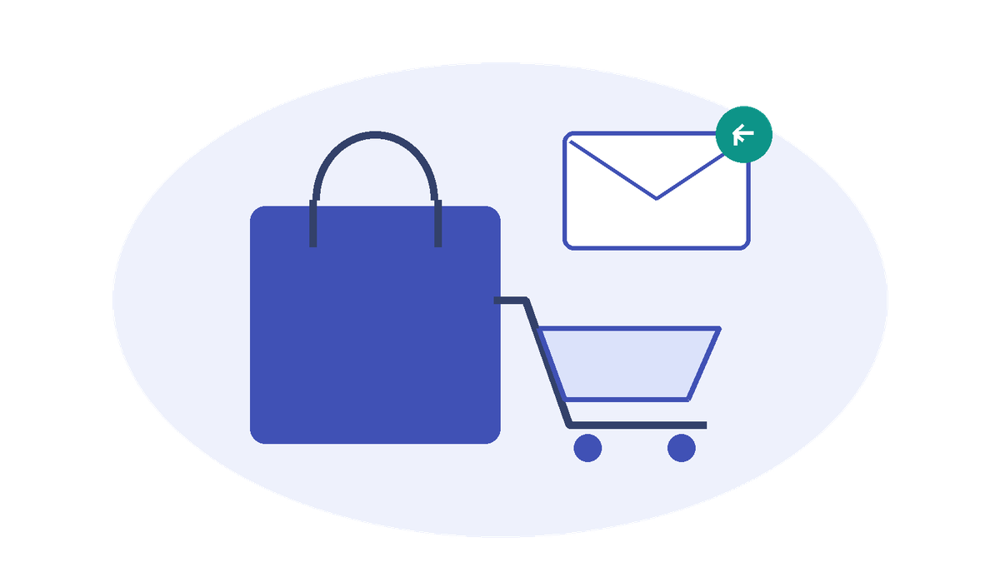
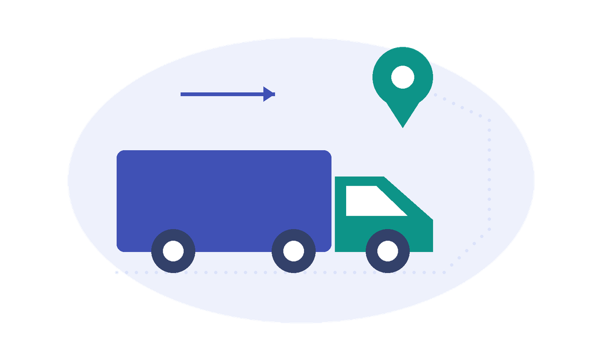

  <section class="h2-hero" aria-labelledby="home2-title">
    

      
Fabric Events

      <h1 id="home2-title">One event. The right action.</h1>
      
A sales dip. A delayed shipment. A moment that matters to your business.

      
<strong>Business Events</strong> let Fabric workloads publish these moments as named, schema-defined signals. Independent consumers turn them into alerts, workflows, and analytics.

      

        <a class="md-button md-button--primary" href="../business-events/scenarios/sales-volume-alert/">Build your first event</a>
        <a href="../business-events/introduction/what-are-business-events/">Understand the basics &rarr;</a>
      

    

    <figure>
      
      <figcaption>Detect a moment. Publish an event. Let consumers react.</figcaption>
    </figure>
  </section>

  <section class="h2-section" aria-labelledby="home2-scenarios-title">
    <h2 id="home2-scenarios-title">Find a moment worth acting on.</h2>
    

      <article class="h2-scene">
        
        <h3>Alert the team.</h3>
        
A Notebook detects a sales dip. A Business Event triggers an Activator rule that sends a Teams alert.

        <a href="../business-events/scenarios/sales-volume-alert/">Build a sales volume alert &rarr;</a>
      </article>
      <article class="h2-scene">
        
        <h3>Bring a customer back.</h3>
        
A cart abandonment event lets independent consumers trigger recovery actions and capture conversion analytics.

        <a href="../business-events/scenarios/abandoned-cart-recovery/">Explore cart recovery &rarr;</a>
      </article>
      <article class="h2-scene">
        
        <h3>Respond to a delay.</h3>
        
A shipment delay event triggers mitigation actions, notifies the customer, and records the incident for analysis.

        <a href="../business-events/scenarios/shipment-delay-auto-mitigation/">Explore shipment mitigation &rarr;</a>
      </article>
    

    
<a href="../business-events/scenarios/">Browse all scenarios &rarr;</a>

  </section>

  <section class="h2-section" aria-labelledby="home2-pillars-title">
    <h2 id="home2-pillars-title">Three pillars. One event-driven toolkit.</h2>
    

      

        <h3>Business Events</h3>
        
Signals your workloads publish when something matters to the business.

        
<a href="../business-events/introduction/what-are-business-events/">Guides available now &rarr;</a>

      

      

        <h3>Fabric Events</h3>
        
Platform signals, such as item creation and workspace changes.

        
<em>Site coverage coming soon.</em>

      

      

        <h3>Azure Events</h3>
        
Cloud signals that connect Azure systems and Fabric workloads.

        
<em>Site coverage coming soon.</em>

      

    

  </section>

  <section class="h2-section" aria-labelledby="home2-resources-title">
    <h2 id="home2-resources-title">Go from an idea to a working solution.</h2>
    
<a href="../business-events/recipes/">Recipes</a> &middot; <a href="../business-events/design-guides/">Design guides</a> &middot; <a href="https://learn.microsoft.com/en-us/fabric/real-time-hub/business-events/business-events-overview">Official documentation</a> &middot; <a href="https://github.com/microsoft/fabric-events/discussions">Join the community</a>

  </section>

